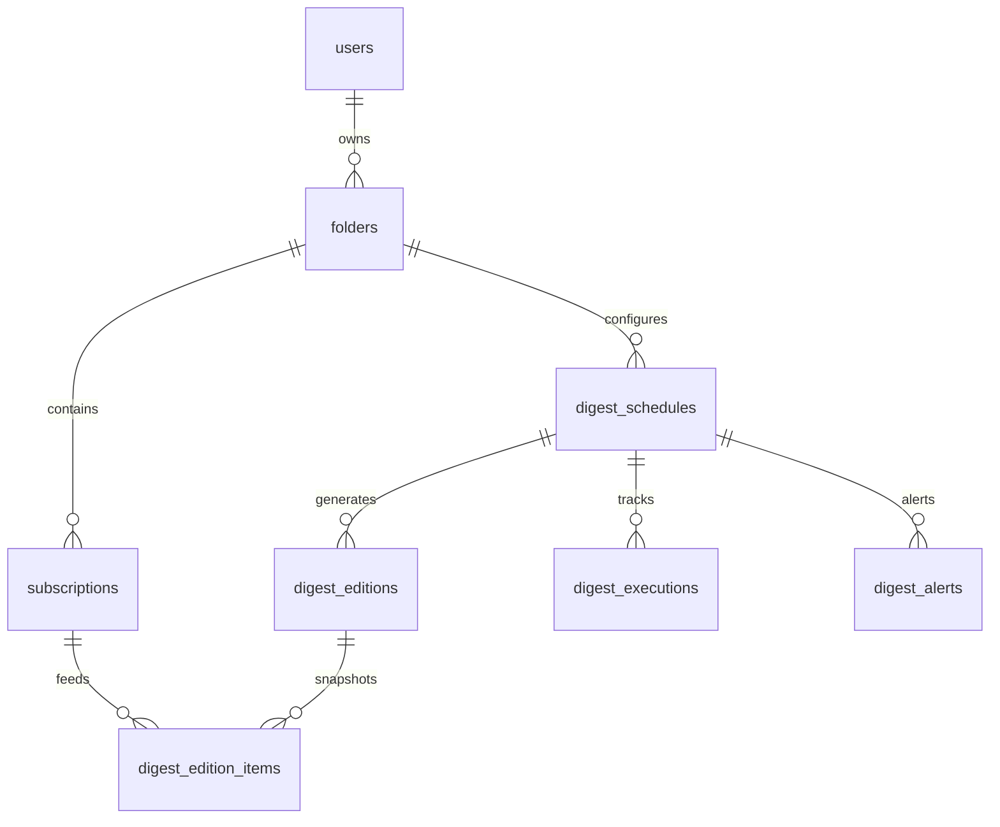
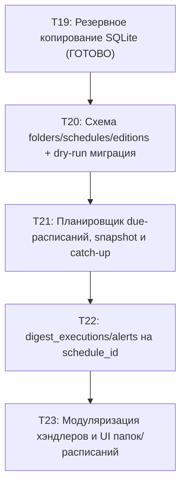

# Проект Очереди 4: несколько расписаний дайджеста на папку

- **Статус**: Проект согласован с решениями владельца ([roadmap.md](../roadmap.md) §2, [research/digest-schedules-architecture.md](../research/digest-schedules-architecture.md)).
- **Цель**: Переход от плоской модели «подписка с периодом» к иерархической модели **«папка → 1..N расписаний → выпуск (снапшот до отправки)»**.
- **Границы этапа**: Текущая задача — исключительно проектная документация (`docs/sprint/queue4-design.md`), read-only скрипт проверки базы (`ops/migrate_schedules_dryrun.py`) и тесты к нему (`tests/test_migrate_schedules_dryrun.py`). Код бота (`main.py`, `data/database.py`, `digest_*.py`) не модифицируется. Реализация схемы и логики запланирована в задачах T20–T23.

---

## 1. Как сейчас устроено в коде

### 1.1. Таблицы базы данных (`data/database.py:init_db`)
1. **`subscriptions`**:
   - Поля: `id`, `user_id`, `channel_username`, `channel_title`, `period` (`'daily'` | `'weekly'` | `'monthly'`), `created_at`, `last_scraped_at`, `next_send_at`, `digest_status`, `failure_count`, `last_error`, `last_attempt_at`, `is_disabled`, `is_paused`, `tag`, `last_post_id`.
   - Индексы: `idx_subscriptions_due (next_send_at, is_disabled)`, `idx_subscriptions_user_active (user_id, is_disabled, next_send_at)`.
   - Ограничения: Нет ограничения уникальности `(user_id, channel_username)`. Пользователь может быть подписан на один и тот же канал в разных периодах (например, `daily` и `weekly`) и с разными тегами (`tag`).
2. **`digest_settings`**:
   - Поля: `user_id`, `period`, `send_hour` (default 7), `send_minute` (default 0), `weekday`, `month_day`, `monthly_mode` (default `'date'`).
   - Ключ: `PRIMARY KEY (user_id, period)`. Ровно одна настройка времени на период для каждого пользователя.
3. **`user_emails`**:
   - Поля: `user_id PRIMARY KEY`, `email`, `email_periods` (строка через запятую, например `'daily,weekly'`), `pending_email`, `verify_code`, `code_sent_at`, `code_expires_at`, `code_attempts`.
   - Эксклюзивность доставки: если период указан в `email_periods` и адрес подтверждён, дайджест уходит на почту, иначе в Telegram (`main.py:get_email_delivery_periods`).
4. **`digest_executions`**:
   - Поля: `id`, `user_id`, `period`, `scheduled_at`, `started_at`, `finished_at`, `status` (`'delivered'` | `'empty'` | `'partial'` | `'retrying'` | `'failed'`), `posts_count`, `channels_count`, `channels_failed`, `channels_partial`, `error_message`, `retry_count`, `created_at`.
   - Уникальность: `uq_digest_executions_user_period_sched UNIQUE(user_id, period, scheduled_at)`.
5. **`digest_alerts`**:
   - Поля: `id`, `user_id`, `period`, `scheduled_at`, `alert_type`, `sent_at`, `message_id`, `error_text`, `created_at`.
   - Уникальность: `UNIQUE(user_id, period, scheduled_at, alert_type)`.
6. **`channel_posts`**:
   - Общее хранилище постов каналов: `(channel_username, post_id) PRIMARY KEY`, `post_text`, `post_link`, `post_time`, `views`, `reactions_total`, `forwards`, `replies`, `metrics_at`, `fwd_from_channel_id`, `fwd_from_post_id`.
7. **`channels`**:
   - Метаданные каналов и общий курсор сканирования: `channel_username PRIMARY KEY`, `subscribers_count`, `subscribers_updated_at`, `channel_id`, `feed_backfilled_at`, `last_scanned_at`, `last_scanned_post_id`.
8. **`digest_posts`**:
   - База знаний доставленных постов: `(user_id, post_link) UNIQUE`, `post_time`, `channel_username`.

### 1.2. Функции и конвейер доставки
- **Выборка due-подписок**: `get_due_subscriptions(current_time_str, limit)` выбирает строки `subscriptions` с `next_send_at <= now` и `is_disabled = 0 AND is_paused = 0`.
- **Группировка в выпуск**: `plan_due_editions(due_subs, now)` (`main.py:5467`) группирует подписки по `user_id`. Использует `digest_edition.plan_daily_edition`:
  - В один календарный день (`local_day_end`, в `APP_TIMEZONE`) формируется **один** выпуск пользователя по времени старшего периода (`monthly` > `weekly` > `daily`).
  - Младшие подписки, наступившие раньше, откладываются (`defer_subscriptions`) до времени старшего.
  - Подписки этого же дня, назначенные на более позднее время, подтягиваются в текущий выпуск (`get_user_subscriptions_due_until`).
- **Сбор постов**: `prefetch_due_channels` вычитывает посты каналов батчем.
- **Курсоры доставки**:
  - `subscriptions.last_post_id` обновляется строго после успешной отправки (`_finish_period_execution` → `update_subscription_time`).
  - Если постов нет, обновляется только расписание следующего запуска (`update_subscription_schedule`).
- **Слабые места текущей схемы**:
  1. *Неидемпотентность отправки*: состав выпуска не сохраняется до отправки. При падении бота между отправкой сообщения в Telegram и обновлением `subscriptions.last_post_id` повторный запуск пересоберёт и заново отправит те же самые посты.
  2. *Ключевание `scheduled_at`*: время execution берётся как `min(sub.next_send_at)` по подпискам периода (`main.py:5280`). При наличии каналов с рассинхронизированным `next_send_at` это порождает дробление execution-записей.
  3. *Жёсткая связь канала с периодом*: канал не может иметь несколько независимых расписаний доставки (например, утренний короткий дайджест и вечерний полный).
  4. *Тег — просто текстовое поле*: нет сущности папки, нельзя задать расписание на тег.

---

## 2. Целевая схема данных (Target Schema DDL)

Модель: **папка (`folders`) → 1..N расписаний (`digest_schedules`) → выпуск (`digest_editions` + `digest_edition_items`)**. Канал привязан к подписке, подписка строго в одной папке (`subscriptions.folder_id`). Курсор доставки (`last_post_id`) остаётся на подписке.



### 2.1. DDL новых таблиц

```sql
-- 1. Папки подписок (бывшие теги)
CREATE TABLE IF NOT EXISTS folders (
    id INTEGER PRIMARY KEY AUTOINCREMENT,
    user_id INTEGER NOT NULL,
    name TEXT NOT NULL,
    is_default INTEGER NOT NULL DEFAULT 0,
    created_at DATETIME NOT NULL,
    UNIQUE(user_id, name)
);
CREATE INDEX IF NOT EXISTS idx_folders_user ON folders(user_id, is_default);

-- 2. Расписания дайджестов на папку (1..N расписаний на папку)
CREATE TABLE IF NOT EXISTS digest_schedules (
    id INTEGER PRIMARY KEY AUTOINCREMENT,
    folder_id INTEGER NOT NULL REFERENCES folders(id) ON DELETE CASCADE,
    user_id INTEGER NOT NULL,
    name TEXT,                                  -- Необязательное понятное имя: "Утренний", "Итоги недели"
    period TEXT NOT NULL,                       -- 'daily' | 'weekly' | 'monthly'
    send_hour INTEGER NOT NULL DEFAULT 9,       -- 0..23
    send_minute INTEGER NOT NULL DEFAULT 0,     -- 0..59
    weekdays TEXT,                              -- Для weekly: '0'..'6' (0=Пн, 6=Вс) или список '0,1,2,3,4'
    month_day INTEGER,                          -- Для monthly: 1..31
    monthly_mode TEXT DEFAULT 'date',           -- 'date' | 'last_day'
    delivery TEXT NOT NULL DEFAULT 'telegram',  -- 'telegram' | 'email' (эксклюзивно)
    email_address TEXT,                         -- Зафиксированный подтверждённый адрес для email-доставки
    is_enabled INTEGER NOT NULL DEFAULT 1,
    next_send_at DATETIME NOT NULL,             -- Время следующего планового срабатывания в UTC
    last_edition_id INTEGER,                    -- Ссылка на последний созданный выпуск
    created_at DATETIME NOT NULL,
    updated_at DATETIME NOT NULL
);
CREATE INDEX IF NOT EXISTS idx_digest_schedules_due ON digest_schedules(is_enabled, next_send_at);
CREATE INDEX IF NOT EXISTS idx_digest_schedules_folder ON digest_schedules(folder_id, is_enabled);
CREATE INDEX IF NOT EXISTS idx_digest_schedules_user ON digest_schedules(user_id, is_enabled);

-- 3. Выпуски дайджеста (Снапшот до отправки, гарантия идемпотентности)
CREATE TABLE IF NOT EXISTS digest_editions (
    id INTEGER PRIMARY KEY AUTOINCREMENT,
    schedule_id INTEGER NOT NULL REFERENCES digest_schedules(id) ON DELETE CASCADE,
    user_id INTEGER NOT NULL,
    folder_id INTEGER NOT NULL REFERENCES folders(id) ON DELETE CASCADE,
    scheduled_at DATETIME NOT NULL,             -- Плановый таймслот выпуска
    status TEXT NOT NULL,                       -- 'pending' | 'building' | 'ready' | 'delivering' | 'delivered' | 'partial' | 'empty' | 'failed' | 'retrying'
    delivery TEXT NOT NULL,                     -- 'telegram' | 'email'
    delivery_target TEXT,                       -- chat_id или email-адрес
    posts_count INTEGER DEFAULT 0,
    channels_count INTEGER DEFAULT 0,
    channels_failed INTEGER DEFAULT 0,
    channels_partial INTEGER DEFAULT 0,
    error_message TEXT,
    retry_count INTEGER DEFAULT 0,
    telegraph_url TEXT,
    created_at DATETIME NOT NULL,
    started_at DATETIME,
    delivered_at DATETIME,
    UNIQUE(schedule_id, scheduled_at)
);
CREATE INDEX IF NOT EXISTS idx_digest_editions_user_status ON digest_editions(user_id, status);
CREATE INDEX IF NOT EXISTS idx_digest_editions_sched_status ON digest_editions(scheduled_at, status);

-- 4. Состав выпуска (Зафиксированные посты снапшота)
CREATE TABLE IF NOT EXISTS digest_edition_items (
    id INTEGER PRIMARY KEY AUTOINCREMENT,
    edition_id INTEGER NOT NULL REFERENCES digest_editions(id) ON DELETE CASCADE,
    subscription_id INTEGER NOT NULL REFERENCES subscriptions(id) ON DELETE CASCADE,
    channel_username TEXT NOT NULL,
    post_id INTEGER NOT NULL,
    post_time DATETIME NOT NULL,
    post_title TEXT,
    post_link TEXT NOT NULL,
    score REAL DEFAULT 0.0,
    rank INTEGER,
    created_at DATETIME NOT NULL,
    UNIQUE(edition_id, channel_username, post_id)
);
CREATE INDEX IF NOT EXISTS idx_edition_items_edition ON digest_edition_items(edition_id);
CREATE INDEX IF NOT EXISTS idx_edition_items_sub ON digest_edition_items(subscription_id);
```

### 2.2. Модификация существующих таблиц
1. **`subscriptions`**:
   - Добавляется поле `folder_id INTEGER REFERENCES folders(id) ON DELETE RESTRICT`.
   - Инвариант: канал строго в одной папке на пользователя:
     ```sql
     CREATE UNIQUE INDEX IF NOT EXISTS uq_subscriptions_user_channel ON subscriptions(user_id, channel_username);
     ```
   - Колонка `tag` остаётся для обратной совместимости на время переходного периода (read-only fallback).
   - Колонка `period` объявляется устаревшей (deprecated legacy). Расписание теперь привязано к папке через `digest_schedules`.
   - Курсор `last_post_id` остаётся на `subscriptions` и двигается только после подтверждённой доставки выпуска (`digest_editions.status IN ('delivered', 'partial')`).
2. **`digest_executions` / `digest_alerts`**:
   - В T22 добавляется `schedule_id INTEGER REFERENCES digest_schedules(id)`.
   - Ключевание переводится на `(schedule_id, scheduled_at)`.
   - Существующие записи остаются как legacy (с `schedule_id IS NULL`, старые `user_id, period, scheduled_at` не трогаются).

---

## 3. Таблица соответствия «было → стало»

| Существующая сущность / колонка | Целевая сущность / колонка | Правило трансформации и назначение |
|---|---|---|
| `subscriptions.tag` (строка или `NULL`) | `folders.name` + `subscriptions.folder_id` | Если `tag` не пустой → создаётся `folders(user_id, name=tag)`. Если `tag IS NULL` или пуст → `folders(user_id, name='Основное', is_default=1)`. Подписка связывается через `folder_id`. |
| `subscriptions.period` (`'daily'`/`'weekly'`/`'monthly'`) | `digest_schedules.period` | Переносится в расписание папки. В `subscriptions` колонка остаётся как legacy; частота получения постов определяется расписаниями папки, в которой состоит канал. |
| `subscriptions.next_send_at` | `digest_schedules.next_send_at` | Планировщик опрашивает `digest_schedules`, а не отдельные подписки. В `subscriptions` поле сохраняется до полного отказа от старого планировщика. |
| `subscriptions.last_post_id` | `subscriptions.last_post_id` | **Без изменений**. Курсор доставки остаётся на подписке. При нескольких расписаниях на одну папку (например, 08:00 и 20:00) утренний выпуск забирает ночные посты и двигает курсор; вечерний выпуск забирает дневные посты от нового курсора. Дублей постов нет. |
| `digest_settings.send_hour`, `send_minute`, `weekday`, `month_day`, `monthly_mode` | `digest_schedules.send_hour`, `send_minute`, `weekdays`, `month_day`, `monthly_mode` | Пользовательские настройки времени переносятся в расписания папки по умолчанию (и папок, каналы которых имели соответствующий период). |
| `user_emails.email_periods` (`'daily,weekly'`) | `digest_schedules.delivery = 'email'`, `digest_schedules.email_address` | Если период был отмечен для отправки на почту И адрес `user_emails.email` подтверждён → соответствующее расписание получает `delivery = 'email'`, `email_address = user_emails.email`. Все остальные расписания получают `delivery = 'telegram'`. |
| `user_emails.email` | `digest_schedules.email_address` | Денормализуется в расписание для изоляции от последующих изменений настроек почты во время доставки. |
| `digest_executions` `(user_id, period, scheduled_at)` | `digest_editions` + `digest_executions(schedule_id, scheduled_at)` | Вся новая история выполнения и повторов привязана к `schedule_id`. Старые строки остаются legacy со старыми ключами. |
| `digest_alerts` `(user_id, period, scheduled_at, alert_type)` | `digest_alerts(schedule_id, scheduled_at, alert_type)` | Дедупликация технических алертов и кнопки повтора привязываются к конкретному расписанию. Старые алерты остаются legacy. |

---

## 4. Миграция данных

### 4.1. Порядок выполнения миграции
1. **Резервная копия**: Вызов штатного проверенного скрипта `python3 ops/aiqu/backup_db.py --tag pre-q4d` (создаёт снимок `bot_data-<stamp>-pre-q4d.db` с проверкой `PRAGMA quick_check`).
2. **Создание DDL**: Создание таблиц `folders`, `digest_schedules`, `digest_editions`, `digest_edition_items`, индекса `idx_digest_schedules_due`. Добавление колонки `subscriptions.folder_id` (через безопасный `ALTER TABLE ADD COLUMN`).
3. **Формирование папок по умолчанию**:
   - Для каждого пользователя с активными подписками создаётся запись `folders(user_id, name='Основное', is_default=1)`.
   - Для каждого уникального непустого `tag` активных подписок создаётся `folders(user_id, name=tag, is_default=0)`.
4. **Разрешение дубликатов каналов и привязка к папкам**:
   - Если пользователь подписан на канал в нескольких периодах с одинаковым тегом → объединение в одну подписку с `last_post_id = MAX(last_post_id)`.
   - Если канал в нескольких разных тегах → применение детерминированного правила разрешения конфликтов (§6.1) и привязка к выбранной папке.
   - Проставление `subscriptions.folder_id = folders.id`.
   - Создание уникального индекса `uq_subscriptions_user_channel`.
5. **Генерация расписаний `digest_schedules`**:
   - Для каждой папки создаются расписания на основе существовавших периодов каналов, попавших в эту папку.
   - Параметры времени (час, минута, дни недели/месяца) берутся из `digest_settings` пользователя для этого периода; если настройки в базе отсутствовали — из системных дефолтов (`07:00` daily, `09:00` weekly Вс, `10:00` monthly 1-е число).
   - Если период входил в `user_emails.email_periods` и `user_emails.email` подтверждён → `delivery = 'email'`, иначе `'telegram'`.
   - Вычисление первого значения `next_send_at` в UTC.
6. **Фиксация в метаданных**:
   - Запись в `app_meta` ключа `schema_queue4 = 'migrated_v1'`.

### 4.2. Идемпотентность и повторный запуск
- Миграционный скрипт оборачивается в транзакцию `BEGIN IMMEDIATE`.
- Перед запуском проверяется `_get_meta(cursor, 'schema_queue4')`. Если миграция уже выполнена, скрипт завершается без изменений.
- DDL-команды используют `CREATE TABLE IF NOT EXISTS`, `ALTER TABLE` защищён перехватом `sqlite3.OperationalError` (колонка уже существует).
- Вставки используют `INSERT INTO ... ON CONFLICT DO NOTHING`.
- Повторный запуск скрипта на уже мигрированной или частично мигрированной базе детерминирован, не создаёт дубликатов папок и расписаний.

### 4.3. Откат миграции (Rollback)
- В случае сбоя миграции или критических дефектов при выкате откат выполняется восстановлением из проверенного снимка T19:
  ```bash
  sqlite3 storage/bot_data.db < /dev/null # проверка блокировок
  cp storage/backups/bot_data-<stamp>-pre-q4d.db storage/bot_data.db
  ```
- Поскольку T19 создаёт валидный SQLite-файл с правами 0600 и проверкой целостности, откат гарантирует мгновенный возврат к стабильному состоянию.

### 4.4. Совместимость старого и нового кода при поэтапном выкате (T20 → T23)
Выкат спроектирован так, чтобы происходить **без остановки сервиса и без big-bang релиза**:
- **Шаг T20 (Схема и миграция)**:
  - Добавляются новые таблицы и колонка `subscriptions.folder_id`.
  - Старый планировщик (`main.py:check_digests`) продолжает работать по `subscriptions.next_send_at` и `subscriptions.period`. Бот полностью работоспособен.
  - Появляется read-only инструмент проверки консистентности `ops/migrate_schedules_dryrun.py`.
- **Шаг T21 (Новый планировщик и снапшоты)**:
  - Планировщик переключается на выборку due-расписаний из `digest_schedules`.
  - Сборка формирует `digest_editions` и `digest_edition_items`.
  - При отправке посты берутся из снапшота выпуска. Повторы идемпотентны по `edition_id`.
  - `subscriptions.last_post_id` обновляется по факту доставки.
  - Обратная совместимость: для фонового мониторинга обновляется и `subscriptions.next_send_at`.
- **Шаг T22 (Алерты и executions на schedule_id)**:
  - `digest_executions` и `digest_alerts` получают `schedule_id`.
  - Кнопка «Повторить» перезапускает выпуск через `digest_editions.status = 'retrying'`.
  - Старые записи остаются доступны для просмотра как legacy.
- **Шаг T23 (UI папок и расписаний)**:
  - До UI расписаний обработчики настроек дайджеста выносятся из `main.py` в отдельный роутер.
  - Включается интерфейс управления папками, добавления нескольких расписаний на папку, перемещения каналов.

---

## 5. Планировщик T21 (Архитектура и граничные случаи)

### 5.1. Запросы и индексы
Вместо опроса сотен строк `subscriptions` каждые 30 минут, планировщик выбирает due-расписания:
```sql
SELECT s.id, s.folder_id, s.user_id, s.period, s.delivery, s.email_address, s.next_send_at
FROM digest_schedules s
WHERE s.is_enabled = 1 AND s.next_send_at <= ?
ORDER BY s.next_send_at ASC
LIMIT ?;
```
- Запрос покрывается составным индексом: `idx_digest_schedules_due ON digest_schedules(is_enabled, next_send_at)`.
- Для каждого due-расписания подписки выбираются одним быстрым запросом по папке:
  ```sql
  SELECT sub.id, sub.channel_username, sub.channel_title, sub.last_post_id
  FROM subscriptions sub
  WHERE sub.folder_id = ? AND sub.is_disabled = 0 AND sub.is_paused = 0;
  ```
- После обработки снапшота планировщик вычисляет следующий `next_send_at` расписания и засыпает до ближайшего `MIN(next_send_at)` среди активных расписаний (с ограничением сверху, например 15–30 минут для подхвата ручных изменений).

### 5.2. Catch-up одним объединённым выпуском при простое
Если бот был остановлен (деплой, сбой сети, простой сервера) на длительное время (например, 36 часов):
- По расписанию наступило несколько плановых сроков (например, вчера в 09:00 и сегодня в 09:00).
- **Правило**: Формируется строго **ОДИН объединённый выпуск (catch-up)**.
- В выпуск входят все посты канала, вышедшие с момента `subscriptions.last_post_id`.
- Срок `scheduled_at` этого выпуска фиксируется как время последнего наступившего слота.
- Поле `next_send_at` расписания не шагает по 1 дню, а сразу переносится на **следующий будущий слот** от текущего момента:
  $$\text{next\_send\_at} = \text{calculate\_next\_slot}(\text{now})$$
- Пользователь не получает лавину из пропущенных дайджестов — приходит одна актуальная сводка за всё время простоя.

### 5.3. Граничные случаи
1. **Часовой пояс пользователя (`user_prefs.timezone`, T15)**:
   - Пользователь настраивает время расписания в своём локальном представлении (например, «08:30 утра»).
   - `digest_schedules.send_hour` и `send_minute` хранятся как локальное настенное время пользователя.
   - `digest_schedules.next_send_at` всегда хранится и рассчитывается строго в **UTC** с учётом `user_tz(user_id)`.
   - При смене часового пояса в `/settings` все `next_send_at` активных расписаний пользователя атомарно пересчитываются.
2. **Переход на летнее/зимнее время (DST)**:
   - Расчёт локального времени через `zoneinfo` корректно обрабатывает сдвиги на 1 час весной и осенью: локальный слот 08:30 остаётся 08:30 утра для пользователя, меняется только его UTC-проекция в `next_send_at`.
3. **Длительный простой (> суток / недели)**:
   - Чтобы не превысить лимиты Telegraph (64 КБ) и не собрать тысячи постов из сверхактивных каналов, в конвейер ранжирования включается стандартный предохранитель скоринга и потолок постов на канал (`MAX_POSTS_PER_CHANNEL`). Сверхлимит сворачивается в строчку «ещё N постов» со ссылкой на канал.
4. **Несколько расписаний на одно время**:
   - Сценарий А: У одного пользователя два расписания для разных папок (например, папка «Новости» и папка «Работа») назначены на 09:00.
     - *Поведение*: Создаются два независимых выпуска `digest_editions` (по одному на расписание/папку). Если оба идут в Telegram — отправляются последовательно двумя сообщениями (или двумя Telegraph-ссылками) с понятными заголовками папок.
     - Оптимизация сети: каналы обеих папок предзагружаются в память общим пулом через `prefetch_due_channels`, исключая повторные запросы по каналам.
   - Сценарий Б: Одно расписание на папку в 09:00 (Telegram) и другое в 09:00 (Email).
     - Доставка разделяется по транспортам; курсор двигается по факту успешной доставки каждого выпуска.

---

## 6. Конфликты данных и стратегия их разрешения

В ходе миграции скрипт `ops/migrate_schedules_dryrun.py` инспектирует базу на предмет следующих конфликтов:

### 6.1. Канал в нескольких тегах у одного пользователя
- **Суть проблемы**: В текущей схеме пользователь мог подписаться на `@durov` с тегом `#tech` в daily и с тегом `#news` в weekly. В целевой схеме действует ограничение: один канал — строго одна папка (`UNIQUE(user_id, channel_username)`).
- **Обнаружение**:
  ```sql
  SELECT user_id, channel_username, COUNT(DISTINCT COALESCE(tag, '')) as tag_cnt,
         GROUP_CONCAT(DISTINCT COALESCE(tag, '<без тега>')) as tags
  FROM subscriptions
  WHERE is_disabled = 0
  GROUP BY user_id, channel_username
  HAVING tag_cnt > 1;
  ```
- **Стратегия разрешения**:
  1. Выбирается папка подписки со **старшим периодом** (`monthly` > `weekly` > `daily`).
  2. При равных периодах побеждает непустой тег перед пустым.
  3. При разных непустых тегах побеждает подписка с наибольшим `last_post_id` (наиболее свежая активность).
  4. Подписки схлопываются в одну запись: `last_post_id = MAX(last_post_id)` (чтобы исключить дублирование старых постов). Вторая запись помечается `is_disabled = 1`.
  5. В сухом отчёте (dry-run) пишется явное предупреждение с указанием каналов и выбранной папки.

### 6.2. Пустые папки
- **Суть проблемы**: Наличие тегов, у которых нет ни одной активной подписки (например, все каналы тега были отключены, либо тег остался только в архиве `saved_messages`).
- **Обнаружение**: Поиск тегов в `subscriptions WHERE is_disabled = 1` или `saved_messages`, для которых нет активных записей в `subscriptions WHERE is_disabled = 0`.
- **Стратегия разрешения**:
  - Для неактивных тегов папки не создаются автоматически при миграции. Создаются только папки, имеющие хотя бы одну активную подписку, плюс папка «Основное» (`is_default = 1`).
  - Если пользователь в будущем создаст пустую папку в UI — она сохраняется, но расписания этой папки не генерируют пустых отправок (состояние `empty`).

### 6.3. Расписание без времени (отсутствие настроек)
- **Суть проблемы**: Пользователь подписан на каналы периода (например, `weekly`), но строки для `(user_id, 'weekly')` в таблице `digest_settings` нет, либо поля `send_hour`/`send_minute` равны `NULL`.
- **Обнаружение**:
  ```sql
  SELECT DISTINCT s.user_id, s.period
  FROM subscriptions s
  LEFT JOIN digest_settings ds ON ds.user_id = s.user_id AND ds.period = s.period
  WHERE s.is_disabled = 0 AND (ds.send_hour IS NULL OR ds.send_minute IS NULL);
  ```
- **Стратегия разрешения**:
  - Применяются детерминированные значения по умолчанию в соответствии с контрактом `get_default_digest_settings`:
    - `daily`: `07:00`
    - `weekly`: `09:00`, воскресенье (`weekday = 6`)
    - `monthly`: `10:00`, 1-е число месяца (`month_day = 1`)
  - В отчёте миграции фиксируется применение дефолтного времени.

### 6.4. Почта без подтверждения
- **Суть проблемы**: В `user_emails.email_periods` прописаны периоды (например, `'daily'`), но колонка `email` пуста или `NULL` (например, пользователь начал ввод через `/email`, заполнил `pending_email`, но не ввёл код подтверждения `verify_code`).
- **Обнаружение**:
  ```sql
  SELECT user_id, pending_email, email_periods
  FROM user_emails
  WHERE (email IS NULL OR email = '') AND (email_periods IS NOT NULL AND email_periods != '');
  ```
- **Стратегия разрешения**:
  - Расписание НЕ переводится на `delivery = 'email'`.
  - Устанавливается безопасный дефолт `delivery = 'telegram'`.
  - Запись об отклонённой неподтверждённой почте выводится в отчёт миграции со статусом предупреждения.

---

## 7. Нарезка на задачи и коммиты (T20…T23)

Каждая задача представляет собой логически изолированный, независимо тестируемый шаг.



### T20. Схема данных folders / digest_schedules / digest_editions и миграция с dry-run
- **Объём**:
  - DDL в `data/database.py:init_db` (создание таблиц, внешние ключи, индексы).
  - Скрипт миграции базы данных `ops/migrate_schedules.py` с флагом транзакции и проверкой контрольных сумм.
  - Read-only диагностический скрипт `ops/migrate_schedules_dryrun.py` (подключение через `mode=ro`).
- **Критерий готовности**:
  - `init_db()` создаёт новые таблицы без регрессий существующих тестов.
  - Dry-run скрипт на чистой базе возвращает код 0, на конфликтной базе — код 3 с детальным списком конфликтов.
  - Повторный запуск миграции идемпотентен.
- **Тесты**: `tests/test_migrate_schedules_dryrun.py`, `tests/test_database_migration_q4.py`.

### T21. Планировщик по due-расписаниям, snapshot выпуска, повтор и catch-up
- **Объём**:
  - Модуль `digest_scheduler.py`: выборка due-расписаний, расчёт интервала сна до следующего события.
  - Сборка выпуска с фиксацией снапшота в `digest_editions` и `digest_edition_items` до вызова Telegram/SMTP API.
  - Идемпотентный повтор: при ошибке отправки повторный запуск отправляет посты строго из существующего снапшота.
  - Механизм catch-up: при задержке > суток генерируется один выпуск, а `next_send_at` перескакивает на ближайший будущий слот.
  - Продвижение курсора `subscriptions.last_post_id` только после фиксации статуса `delivered`/`partial`.
- **Критерий готовности**:
  - Имитация сетевого сбоя при отправке не приводит к повторному сбору постов и дублированию.
  - Отсутствие starvation при большом числе расписаний.
- **Тесты**: `tests/test_digest_schedules_scheduler.py`, `tests/test_digest_edition_snapshot.py`, `tests/test_digest_catchup.py`.

### T22. Перевод digest_executions и digest_alerts на schedule_id
- **Объём**:
  - Привязка записей `digest_executions` и `digest_alerts` к `schedule_id + scheduled_at`.
  - Маркировка исторической информации как legacy (`schedule_id IS NULL`).
  - Адаптация логики технических алертов (`digest_alerts.py`): кулдауны, антиспам, кнопки «Повторить сейчас» и «Пауза 24ч» работают через `schedule_id`.
- **Критерий готовности**:
  - Кнопка «Повторить» в техническом алерте перезапускает конкретное расписание через его `schedule_id`.
  - Корректная дедупликация алертов per-schedule.
- **Тесты**: `tests/test_digest_alerts_schedules.py`, `tests/test_digest_executions_schedules.py`.

### T23. Вынос дайджест-хэндлеров из main.py и новый UI «папка → расписания»
- **Объём**:
  - Выделение обработчиков дайджеста, FSM-состояний и inline-клавиатур из монолита `main.py` в роутер `handlers/digest_settings.py` (или `digest_ux.py`).
  - Реализация интерфейса папок: «📁 Мои папки», создание папки, перемещение канала в другую папку.
  - Реализация интерфейса расписаний: добавление расписания к папке (выбор времени, дней недели, канала доставки Telegram/Email).
- **Критерий готовности**:
  - `main.py` сокращается минимум на 800+ строк.
  - Пользователь может в чате добавить второе расписание на папку и получать дайджест дважды в день.
- **Тесты**: `tests/test_digest_settings_router.py`, `tests/test_folders_ux.py`.

---

## 8. Риски и открытые вопросы к владельцу

Ниже представлены ключевые развилки проекта (не более 7), сформулированные как выбор из конкретных вариантов:

1. **Конфликт папок при наличии канала в нескольких подписках с разными тегами**:
   - **Вариант А (Рекомендуется)**: Автоматически привязать канал к папке подписки с более старшим периодом (`monthly` > `weekly` > `daily`), при равенстве — по максимальному `last_post_id`. Курсор установить в `MAX(last_post_id)`.
   - **Вариант Б**: Создавать специальную системную папку «Разобрать» («Конфликты») и складывать спорные каналы туда.
   - *Решение для проекта*: Выбран **Вариант А** как полностью автоматический и не требующий ручных действий пользователя при миграции.

2. **Привязка времени расписания к часовому поясу пользователя**:
   - **Вариант А (Рекомендуется)**: Время расписания задаётся и отображается в персональном часовом поясе пользователя (`user_prefs.timezone`, T15), если он задан, либо в системном `APP_TIMEZONE`.
   - **Вариант Б**: Расписания настраиваются строго в едином `APP_TIMEZONE` (как работало до T15).
   - *Решение для проекта*: Выбран **Вариант А**, так как персональные часовые пояса уже поддержаны в T15 для напоминаний.

3. **Имя папки по умолчанию для каналов без тега**:
   - **Вариант А (Рекомендуется)**: «Основное» (`is_default = 1`).
   - **Вариант Б**: «Без папки» (`is_default = 1`).
   - *Решение для проекта*: Выбран **Вариант А** («Основное»), так как это соответствует общепринятому UX почтовых и RSS-клиентов.

4. **Действие при удалении папки, в которой остались каналы (T23 UI)**:
   - **Вариант А (Рекомендуется)**: Автоматически перемещать оставшиеся каналы в папку по умолчанию («Основное») с сохранением их курсоров доставки.
   - **Вариант Б**: Запрещать удаление папки, пока пользователь вручную не перенесёт каналы или не отпишется от них.
   - **Вариант В**: Удалять папку вместе с подписками (с обязательным подтверждением «Удалить папку и N каналов»).
   - *Решение для проекта*: Выбран **Вариант А** как наиболее безопасный против случайной потери подписок.

5. **Ограничение объёма catch-up выпуска при простое более 7 дней**:
   - **Вариант А (Рекомендуется)**: Ограничивать окно выборки постов для catch-up дайджеста разумным потолком (не более 7 дней назад от момента старта), даже если курсор отстал сильнее.
   - **Вариант Б**: Собирать все посты строго с `last_post_id`, полагаясь на усечение Telegraph (64 КБ) и скоринг постов.
   - *Решение для проекта*: Выбран **Вариант А**, чтобы исключить выедание памяти и перегрузку при многомесячных простоях.

6. **Обработка неподтверждённого email при миграции**:
   - **Вариант А (Рекомендуется)**: Если адрес не подтверждён, создавать расписание с `delivery = 'telegram'` и фиксировать предупреждение в отчёте миграции.
   - **Вариант Б**: Создавать расписание с `delivery = 'email'`, но ставить `is_enabled = 0` (отключено до подтверждения).
   - *Решение для проекта*: Выбран **Вариант А**, так как пользователь не должен терять доставку дайджеста в Telegram из-за незавершённого подтверждения почты.

7. **Несколько расписаний одной папки на один и тот же день (например, утро 08:00 и вечер 20:00)**:
   - **Вариант А (Рекомендуется)**: Каждое расписание доставляет посты, появившиеся с момента предыдущей доставки (`last_post_id`), независимо от периода. Утренний выпуск отдаёт ночные посты, вечерний — дневные.
   - **Вариант Б**: Принудительно объединять расписания одного дня в один выпуск (как делал старый `digest_edition.py`).
   - *Решение для проекта*: Выбран **Вариант А** — это главная цель Очереди 4 (несколько выпусков в день для одной подборки каналов).
