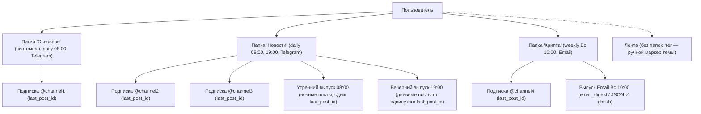
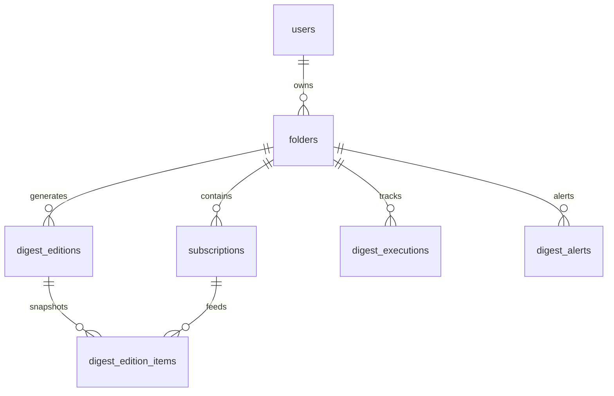
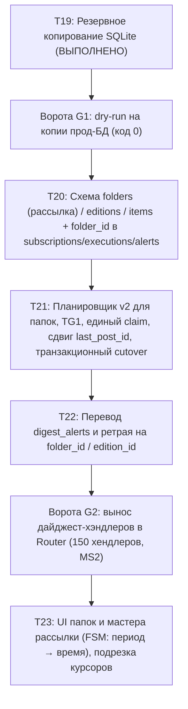

# Проект Очереди 4: модель «папка = одна рассылка» (Архитектура v3)

- **Статус**: Проект переработан под окончательную модель «папка = одна рассылка» на основе решений владельца от 17–18.10.2026 ([owner-decisions-2026-10-17.md](owner-decisions-2026-10-17.md)) и аудита Argon от 18.10.2026 ([argon-owner-model-2026-10-18.md](argon-owner-model-2026-10-18.md)).
- **Окончательные решения владельца (18.10.2026)**:
  1. *Папка дайджеста = одна рассылка с ОДНИМ расписанием*: только день, или только неделя, или только месяц; одно время отправки. У ежедневной папки опционально настраиваются дополнительные слоты (например, утро 08:00 и вечер 19:00) исключительно в настройках папки. Системная папка «Основной» (`is_default = 1`) обслуживает подписки без папки (`tag IS NULL`), не удаляется, пустая — скрыта в UI (`next_send_at = NULL`).
  2. *Курсор — один на подписку* (существующий `subscriptions.last_post_id`): канал состоит ровно в одной папке. Отдельная таблица курсоров на пару `(расписание, подписка)` из проекта **полностью исключена**.
  3. *Мастер новой папки*: период → время → (доставка — шаг скрыт, пока вариант один: Telegram). Папка и подписка создаются одной транзакцией в конце мастера. В существующую папку канал добавляется без промежуточных шагов.
  4. *Перенос канала / смена периода папки*: курсор подписки подрезается окном нового периода (`now - new_period`) и пересчитывается `next_send_at` (исключает попадание месячных постов в дневной выпуск). Удаление папки предлагает выбор: `[Перенести в Основной]` / `[Отписаться]`.
  5. *Почта без ворот G3*: email-подписки мигрируют в папки с `delivery = 'email'` (без шага в UI); планировщик для email вызывает текущий `email_digest` (формат TG1); позже — замена вызова на запись контракта JSON v1 в спул для сервиса `ghsub`, старый email-путь `period` удаляется в переходе.
  6. *Конфликты данных*: канал в нескольких папках/периодах; неоднородный `period` внутри папки (включая `tag IS NULL`) — скрипт dry-run показывает как конфликт с кодом возврата **3**, автоматическое разрешение не производится. Владелец устраняет конфликты вручную до миграции; миграция строгая.
- **Границы этапа**: Проектная документация (`docs/sprint/queue4-design.md`), strictly read-only инструмент проверки базы данных (`ops/migrate_schedules_dryrun.py`) и тесты к нему (`tests/test_migrate_schedules_dryrun.py`). Код бота (`main.py`, `data/database.py`, `digest_*.py`) не модифицируется до реализации задач T20–T23; резервное копирование SQLite перед деплоем (T19) уже выполнено.

---

## 1. Новая модель «папка = одна рассылка»



### 1.1. Суть архитектурного упрощения
- Прежняя модель («папка → три периода → слоты») являлась фрактальной и перегруженной. Зрелые продукты агрегации контента (Mailbrew, Readwise Daily Digest) используют плоскую структуру: **рассылка = источники + одно правило отправки**.
- В новой модели **каждая папка дайджеста представляет собой ровно одну рассылку с одним расписанием**:
  - Ровно один период: только день (`daily`), или только неделя (`weekly`), или только месяц (`monthly`).
  - Одно базовое время доставки (`send_hour`, `send_minute`).
  - Один транспорт доставки (`delivery`: `'telegram'` или `'email'`).
- **Канал пользователя принадлежит ровно одной папке**:
  - Курсор доставки — **строго один на подписку** (колонка `subscriptions.last_post_id`).
  - Нет необходимости в отдельной таблице `digest_schedule_cursors`.
  - Если канал ранее был подписан одновременно на daily и weekly: он остаётся в daily (более детальный поток); для недельного среза пользователю предлагается ссылка на Ленту за неделю.

### 1.2. Системная папка «Основной»
- Подписки без указания папки (`tag IS NULL` или пустая строка) автоматически относятся к системной папке **«Основное»** (`is_default = 1`).
- Системную папку нельзя удалить.
- Если в «Основном» нет активных каналов (все каналы распределены по тематическим папкам), папка скрывается из пользовательского интерфейса, а её расписание деактивируется (`next_send_at = NULL`), не создавая холостых циклов отправки.

### 1.3. Слоты времени у ежедневной папки
- Слоты времени (например, отправка в 08:00 и 19:00) доступны **только для ежедневных папок (`daily`)** и настраиваются **исключительно в расширенных настройках уже созданной папки**.
- Внутри ежедневной рассылки действует единый курсор подписки `subscriptions.last_post_id`:
  - Утренний слот (08:00) отбирает ночные публикации и сдвигает `last_post_id`.
  - Вечерний слот (19:00) отбирает публикации с момента утреннего сдвига и вновь двигает `last_post_id`.
  - Публикации между слотами одной рассылки не дублируются.

### 1.4. Мастер создания новой папки (UX T23)
- Пошаговый FSM-мастер в Telegram-боте:
  1. Ввод названия папки.
  2. Выбор периода: `[День]` / `[Неделя]` / `[Месяц]`.
  3. Выбор времени отправки: `[08:00]`, `[09:00]`, `[19:00]` или ввод своего `ЧЧ:ММ`.
  4. Шаг «доставка» скрыт, пока поддерживается только Telegram (для email — см. раздел 7).
- **Атомарность**: папка в `folders` и подписка в `subscriptions` создаются в **единой SQL-транзакции** в самом конце мастера после выбора времени. Это гарантирует отсутствие «мёртвых» пустых папок без расписания.
- Добавление канала в существующую папку выполняется мгновенно в один клик без повторного прохождения шагов настройки времени.

### 1.5. Жизненный цикл: перенос канала, смена периода, удаление
- **Перенос канала в другую папку / смена периода папки**:
  - Курсор `subscriptions.last_post_id` подрезается окном нового периода:
    $$\text{last\_post\_id} = \max(\text{last\_post\_id}, \text{post\_id\_at}(\text{now} - \text{new\_period}))$$
  - Время `next_send_at` пересчитывается.
  - Это исключает ситуацию, когда канал, перенесённый из ежемесячной папки в ежедневную, вываливает в ближайший утренний дайджест публикации за весь прошлый месяц.
- **Удаление папки**:
  - При наличии каналов бот запрашивает подтверждение с выбором:
    `[Перенести каналы в Основной]` / `[Отписаться от каналов]`.
  - При переносе в «Основной» курсоры каналов также подрезаются окном периода папки «Основное».

### 1.6. Лента (feed) и теги
- В Ленте папок нет. Поле `feed_subscriptions.tag` является исключительно ручным текстовым маркером темы перед заголовком карточки.
- Вопрос автодоставки Ленты отложен владельцем до 24.10.2026. Расписания дайджестов на Ленту не влияют; Лента продолжает использовать отдельный механизм `feed_autodelivery` и настройки `APP_TIMEZONE`.

### 1.7. Формат выпуска TG1
- Все выпуски (Telegram-сообщения, Telegraph-страницы и почтовые рассылки) строятся по утверждённому стандарту **TG1**:
  - Оглавление с перечнем каналов.
  - Структурированные карточки: до 3 главных постов на канал с тегом `<br>` между жирным заголовком и сутью.
  - Блок «Коротко»: маркированный список ссылок-заголовков для остальных публикаций.

---

## 2. Анализ существующей схемы в коде

### 2.1. Таблицы базы данных (`data/database.py:init_db`)
1. **`subscriptions`**:
   - Поля: `id`, `user_id`, `channel_username`, `channel_title`, `period`, `created_at`, `last_scraped_at`, `next_send_at`, `digest_status`, `failure_count`, `last_error`, `last_attempt_at`, `is_disabled`, `is_paused`, `tag`, `last_post_id`.
   - Частичный индекс `uq_subscriptions_user_channel_period_active UNIQUE(user_id, channel_username, period) WHERE is_disabled = 0`.
   - В v1 допускались дубликаты одного канала у пользователя в разных периодах.
2. **`digest_settings`**:
   - Поля: `user_id`, `period`, `send_hour`, `send_minute`, `weekday`, `month_day`, `monthly_mode`. Ключ: `PRIMARY KEY (user_id, period)`.
   - Дефолты из кода (`digest_settings.py:110`): `send_hour=7`, `send_minute=0`, `weekday=now.weekday()`, `month_day=now.day`, `monthly_mode='date'`.
3. **`user_emails`**:
   - Поля: `user_id PRIMARY KEY`, `email`, `email_periods` (TEXT default `''`), `pending_email`, `verify_code`, `code_sent_at`, `code_expires_at`, `code_attempts`.
   - В новой модели email-подписки мигрируют в папки с `delivery = 'email'`, старый путь `email_periods` выводится из эксплуатации.
4. **`digest_executions`**:
   - Поля: `id`, `user_id`, `period`, `scheduled_at`, `started_at`, `finished_at`, `status`, `posts_count`, `channels_count`, `channels_failed`, `channels_partial`, `error_message`, `retry_count`, `created_at`.
   - Индекс `uq_digest_executions_user_period_sched UNIQUE(user_id, period, scheduled_at)`.
   - Статусы: `'delivered'`, `'empty'`, `'partial'`, `'failed'`, `'retrying'`.
5. **`digest_alerts`**:
   - Поля: `id`, `user_id`, `period`, `scheduled_at`, `alert_type`, `sent_at NOT NULL`, `message_id`, `error_text`, `created_at NOT NULL`.
   - Ограничение: `UNIQUE(user_id, period, scheduled_at, alert_type)`.
6. **`user_prefs`**:
   - Поля: `user_id PRIMARY KEY`, `timezone`, `morning_hour`, `day_hour`, `evening_hour`, `updated_at`. Колонка `digest_scheduler_version` в исходной схеме отсутствует.
7. **`channel_posts`**:
   - Поля: `channel_username`, `post_id`, `post_text`, `post_link`, `post_time`, `source`, `created_at`, `views`, `reactions_total`, `reactions_json`, `forwards`, `replies`, `metrics_at`, `fwd_from_channel_id`, `fwd_from_post_id`. Очистка через 30 дней.
8. **`channels`** и **`digest_posts`**:
   - Метаданные каналов и индекс дедупликации `uq_digest_posts_user_link UNIQUE(user_id, post_link)`.

### 2.2. Архитектурные дефекты планировщика v1
- **Отсутствие снапшота до отправки**: формирование на лету приводит к дублированию или потере постов при сбое между сетевым вызовом и коммитом SQLite.
- **Стягивание всех due-подписок до конца дня**: `plan_due_editions` выбирает все подписки пользователя до `day_end`, ломая разделение на утренний и вечерний слоты.
- **Жёсткая привязка канала к периоду**: канал привязан к периодичности в строке подписки, а не к сущности рассылки.

---

## 3. Целевая схема данных (Target Schema DDL)

Модель: **папка-рассылка (`folders`) → выпуск (`digest_editions` + `digest_edition_items`)**.
Курсор доставки: **один на подписку в таблице `subscriptions.last_post_id`**.



### 3.1. DDL новых таблиц

```sql
-- 1. Папки дайджеста (Папка = одна рассылка с расписанием)
CREATE TABLE IF NOT EXISTS folders (
    id INTEGER PRIMARY KEY AUTOINCREMENT,
    user_id INTEGER NOT NULL,
    name TEXT NOT NULL,
    is_default INTEGER NOT NULL DEFAULT 0,
    period TEXT NOT NULL,                       -- 'daily' | 'weekly' | 'monthly'
    times TEXT NOT NULL DEFAULT '["07:00"]',    -- JSON-массив слотов: ["08:00"] или ["08:00","19:00"]
    send_hour INTEGER NOT NULL DEFAULT 7,       -- Час ближайшего планового слота (0..23)
    send_minute INTEGER NOT NULL DEFAULT 0,     -- Минута ближайшего планового слота (0..59)
    weekdays TEXT,                              -- Для weekly: '0'..'6' (0=Пн, 6=Вс)
    month_day INTEGER,                          -- Для monthly: 1..31
    monthly_mode TEXT DEFAULT 'date',           -- 'date' | 'weekday' | 'last_day'
    delivery TEXT NOT NULL DEFAULT 'telegram',  -- 'telegram' | 'email'
    is_enabled INTEGER NOT NULL DEFAULT 1,
    next_send_at DATETIME,                      -- Время ближайшего слота в UTC (NULL если пустой Основной)
    last_edition_id INTEGER,                    -- ID последнего созданного выпуска
    created_at DATETIME NOT NULL,
    updated_at DATETIME NOT NULL,
    UNIQUE(user_id, name),
    CHECK (period IN ('daily', 'weekly', 'monthly')),
    CHECK (send_hour BETWEEN 0 AND 23),
    CHECK (send_minute BETWEEN 0 AND 59),
    CHECK (monthly_mode IN ('date', 'weekday', 'last_day')),
    CHECK (delivery IN ('telegram', 'email'))
);
CREATE INDEX IF NOT EXISTS idx_folders_due ON folders(is_enabled, next_send_at) WHERE next_send_at IS NOT NULL;
CREATE INDEX IF NOT EXISTS idx_folders_user ON folders(user_id, is_enabled);

-- 2. Выпуски дайджеста (Снапшот до отправки, гарантия идемпотентности)
CREATE TABLE IF NOT EXISTS digest_editions (
    id INTEGER PRIMARY KEY AUTOINCREMENT,
    folder_id INTEGER NOT NULL REFERENCES folders(id) ON DELETE CASCADE,
    user_id INTEGER NOT NULL,
    scheduled_at DATETIME NOT NULL,             -- Время сработавшего слота выпуска
    status TEXT NOT NULL,                       -- 'pending' | 'building' | 'ready' | 'delivering' | 'delivered' | 'partial' | 'empty' | 'failed' | 'retrying'
    delivery TEXT NOT NULL DEFAULT 'telegram',  -- 'telegram' | 'email'
    delivery_target TEXT,                       -- chat_id получателя или email-адрес
    posts_count INTEGER DEFAULT 0,
    channels_count INTEGER DEFAULT 0,
    channels_failed INTEGER DEFAULT 0,
    channels_partial INTEGER DEFAULT 0,
    error_message TEXT,
    retry_count INTEGER DEFAULT 0,
    telegraph_url TEXT,
    created_at DATETIME NOT NULL,
    started_at DATETIME,
    delivered_at DATETIME,
    UNIQUE(folder_id, scheduled_at)
);
CREATE INDEX IF NOT EXISTS idx_digest_editions_user_status ON digest_editions(user_id, status);
CREATE INDEX IF NOT EXISTS idx_digest_editions_sched_status ON digest_editions(scheduled_at, status);

-- 3. Состав выпуска (Зафиксированные посты снапшота, включая текст поста для ретрая)
CREATE TABLE IF NOT EXISTS digest_edition_items (
    id INTEGER PRIMARY KEY AUTOINCREMENT,
    edition_id INTEGER NOT NULL REFERENCES digest_editions(id) ON DELETE CASCADE,
    subscription_id INTEGER NOT NULL REFERENCES subscriptions(id) ON DELETE CASCADE,
    channel_username TEXT NOT NULL,
    post_id INTEGER NOT NULL,
    post_time DATETIME NOT NULL,
    post_title TEXT,
    post_text TEXT,                             -- Текст поста для ретрая без обращения к channel_posts
    post_link TEXT NOT NULL,
    score REAL DEFAULT 0.0,
    rank INTEGER,
    created_at DATETIME NOT NULL,
    UNIQUE(edition_id, channel_username, post_id)
);
CREATE INDEX IF NOT EXISTS idx_edition_items_edition ON digest_edition_items(edition_id);
CREATE INDEX IF NOT EXISTS idx_edition_items_sub ON digest_edition_items(subscription_id);
```

### 3.2. Модификация существующих таблиц
1. **`user_prefs`**:
   - Добавляется колонка: `ALTER TABLE user_prefs ADD COLUMN digest_scheduler_version TEXT DEFAULT 'v1';`.
   - Дефолт `'v1'` сохраняет legacy-планировщик для существующих пользователей до персонального cutover.
2. **`subscriptions`**:
   - Добавляется колонка: `ALTER TABLE subscriptions ADD COLUMN folder_id INTEGER REFERENCES folders(id) ON DELETE RESTRICT;`.
   - Индекс: `CREATE INDEX IF NOT EXISTS idx_subscriptions_folder ON subscriptions(folder_id, is_disabled);`.
   - Курсор — существующее поле `subscriptions.last_post_id`.
   - Глобальный индекс `uq_subscriptions_user_channel` на шаге T20 **НЕ создаётся** (отложен до cutover всех пользователей), чтобы не ломать v1-хэндлеры.
3. **`digest_executions` и `digest_alerts`**:
   - Добавляется колонка `folder_id INTEGER REFERENCES folders(id)`:
     ```sql
     CREATE UNIQUE INDEX IF NOT EXISTS uq_digest_executions_folder_slot
         ON digest_executions(folder_id, scheduled_at) WHERE folder_id IS NOT NULL;

     CREATE UNIQUE INDEX IF NOT EXISTS uq_digest_alerts_folder_slot
         ON digest_alerts(folder_id, scheduled_at, alert_type) WHERE folder_id IS NOT NULL;
     ```
   - Исторические записи v1 остаются с `folder_id IS NULL`.
4. **Включение внешних ключей**:
   - Для всех соединений активируется `PRAGMA foreign_keys = ON;`.

### 3.3. Правило движения курсора доставки (Матрица статусов)

Курсор подписки `subscriptions.last_post_id` двигается **ТОЛЬКО при подтверждённой доставке** строго в той же транзакции SQLite, что и смена статуса выпуска в `delivered` или `partial`:

| Статус выпуска (`status`) | Действие с курсором `subscriptions.last_post_id` | Транзакционность и детали |
|---|---|---|
| `delivered` | **Сдвигается** до `MAX(post_id)` из снапшота для каждой подписки, чьи посты вошли в выпуск. | Атомарно: `UPDATE digest_editions SET status='delivered' ...` + `UPDATE subscriptions SET last_post_id=... WHERE id=?`. Если у канала не было постов, курсор остаётся неизменным. |
| `partial` | **Сдвигается ЧАСТИЧНО** — только для каналов, чьи посты успешно отправлены. | Для сбойных каналов курсор **НЕ сдвигается**; невошедшие посты будут отправлены в следующем слоте. |
| `empty` | **НЕ сдвигается**. Выборка вернула 0 постов. | Курсоры остаются на месте. Обновляется только `folders.next_send_at` на следующий будущий слот. |
| `failed` | **НЕ сдвигается** ни для одной подписки. | Курсоры не меняются. Выпуск доступен для алерта или повтора. |
| `retrying` | **НЕ сдвигается**. Идёт повторная отправка. | Состав постов берётся **СТРОГО из `digest_edition_items`**, а не вычитывается заново. |
| `pending` / `building` / `ready` / `delivering` | **НЕ сдвигается**. Промежуточные фазы. | Курсоры фиксированы до ответа от внешнего транспорта. |

---

## 4. Миграция данных и переходный период (Cutover v1 → v2)

### 4.1. Порядок выполнения миграции (T20)
1. **Резервная копия T19**: снимок базы `ops/aiqu/backup_db.py --tag pre-q4s` с верификацией `PRAGMA quick_check`.
2. **Строгая валидация (Ворота G1)**: запуск `ops/migrate_schedules_dryrun.py`. Если код 3 — миграция блокируется, владелец разрешает конфликты вручную. Миграция запускается только при коде 0.
3. **DDL-транзакция**: создание таблиц `folders`, `digest_editions`, `digest_edition_items`, добавление колонок `folder_id` в `subscriptions`, `digest_executions`, `digest_alerts` и `digest_scheduler_version` в `user_prefs`.
4. **Формирование папок по пользователям**:
   - Группа подписок без тега (`tag IS NULL` или пустой) образует системную папку «Основное» (`is_default = 1`).
   - Каждая группа подписок с непустым `TRIM(tag)` образует папку с соответствующим именем.
   - Период папки: берется из однородного `period` её подписок (`daily`, `weekly`, `monthly`).
   - Время и параметры: из `digest_settings` пользователя для этого периода; при отсутствии — дефолт из кода (`07:00`, текущий день недели/месяца, `monthly_mode='date'`).
   - Доставка: если пользователь имеет подтверждённый email в `user_emails` и данный `period IN email_periods`, папка получает `delivery = 'email'`; иначе `delivery = 'telegram'`.
   - Привязка подписок: `UPDATE subscriptions SET folder_id = ? WHERE id = ?`.
5. **Курсоры**: отдельный backfill не требуется — актуальный курсор уже находится в `subscriptions.last_post_id`.
6. **Все пользователи остаются на `v1`**: `digest_scheduler_version = 'v1'`.

### 4.2. Идемпотентность и откат (Rollback)
- Мигратор выполняется в транзакции `BEGIN IMMEDIATE` с `busy_timeout = 5000`.
- Все вставки защищены `ON CONFLICT DO NOTHING`.
- **Откат**: в случае необходимости откат выполняется через штатную процедуру с остановкой контейнера бота (`docker compose stop unagi-bot`) и восстановлением через `ops/aiqu/restore_db.py`. Запись `cp` поверх живой WAL-БД запрещена.

### 4.3. Cutover v1 → v2 в одной транзакции на пользователя

Перевод пользователя с версии v1 на v2 выполняется атомарно, исключая дублирование и пропуски:

```mermaid
sequenceDiagram
    autonumber
    participant Admin as Мигратор / Администратор
    participant DB as SQLite (BEGIN IMMEDIATE)
    participant V1 as Планировщик v1 (Legacy)
    participant V2 as Планировщик v2 (Target)

    Admin->>DB: BEGIN IMMEDIATE
    Note over Admin,DB: 1. Проверка отсутствия in-flight выпусков v1 для user_id
    Admin->>DB: UPDATE folders SET next_send_at = calculate_next_slot(now) WHERE user_id = ?
    Note over Admin,DB: 2. Расчёт ближайшего будущего слота (исключает catch-up лавину)
    Admin->>DB: UPDATE subscriptions SET next_send_at = NULL WHERE user_id = ?
    Note over Admin,DB: 3. Исключение пользователя из выборки v1
    Admin->>DB: UPDATE user_prefs SET digest_scheduler_version = 'v2' WHERE user_id = ?
    Admin->>DB: COMMIT
    Note over V1,V2: V1 больше не видит пользователя; V2 подхватывает строго со следующего слота
```

**Алгоритм cutover**:
1. Открывается транзакция `BEGIN IMMEDIATE`.
2. **Проверка in-flight**: проверка, что для пользователя в данный момент не идёт цикл формирования/отправки в v1.
3. **Установка следующего слота строго в будущее**: `folders.next_send_at` рассчитывается функцией `calculate_next_slot(now)`. Это исключает ложный catch-up за время нахождения на v1.
4. **Снятие расписаний v1**: `subscriptions.next_send_at = NULL`. Старый планировщик немедленно прекращает обработку подписок пользователя.
5. **Переключение версии**: `user_prefs.digest_scheduler_version = 'v2'`.
6. Фиксация транзакции `COMMIT`.
*Результат*: одновременная отправка одного дайджеста из v1 и v2 физически невозможна.

### 4.4. Dual-write смены времени в переходный период
- В переходный период при изменении времени дайджеста через `/settings` (`reschedule_user_period`):
  1. Обновляются legacy-таблицы `digest_settings` и `subscriptions.next_send_at` (для v1).
  2. Выполняется dual-write в `folders`: обновляются `send_hour`, `send_minute`, `times` и пересчитывается `folders.next_send_at` (для v2).
- При cutover время `folders.next_send_at` дополнительно валидируется и синхронизируется.

---

## 5. Планировщик v2 (Архитектура и гарантии доставки)

### 5.1. Запросы выборки и единый claim выпуска
Планировщик v2 опрашивает due-папки каждые 60 секунд:
```sql
SELECT f.id, f.user_id, f.name, f.period, f.times, f.send_hour, f.send_minute, f.delivery, f.next_send_at
FROM folders f
JOIN user_prefs p ON p.user_id = f.user_id
WHERE f.is_enabled = 1
  AND f.next_send_at IS NOT NULL
  AND f.next_send_at <= ?
  AND p.digest_scheduler_version = 'v2'
ORDER BY f.next_send_at ASC
LIMIT 50;
```

**Единый claim выпуска (At-least-once + идемпотентность по `edition_id`)**:
- Сетевая отправка во внешний транспорт (Telegram Bot API или email) и транзакция в локальной SQLite не образуют единой распределенной 2PC-транзакции. Планировщик реализует семантику **at-least-once** с дедупликацией:
  ```sql
  INSERT INTO digest_editions (folder_id, user_id, scheduled_at, status, delivery, created_at)
  VALUES (?, ?, ?, 'building', ?, CURRENT_TIMESTAMP)
  ON CONFLICT(folder_id, scheduled_at) DO NOTHING;
  ```
- Если запись вставлена (`rowcount == 1`), воркер монопольно захватил слот выпуска.
- Воркер собирает посты каналов папки, формирует снапшот в `digest_edition_items`, переводит статус в `'ready'`, затем в `'delivering'`.
- Отправка:
  - При `delivery = 'telegram'`: вызов Telegram Bot API.
  - При `delivery = 'email'`: вызов текущего `email_digest` (в дальнейшем — запись JSON v1 в файловый спул `ghsub`).
- При подтверждении доставки в единой SQLite-транзакции:
  1. `UPDATE digest_editions SET status = 'delivered', delivered_at = CURRENT_TIMESTAMP WHERE id = ?`.
  2. `UPDATE subscriptions SET last_post_id = ? WHERE id = ?` (для каналов выпуска).
  3. `UPDATE folders SET next_send_at = calculate_next_slot(now), last_edition_id = ? WHERE id = ?`.

### 5.2. Слоты времени ежедневной папки
- Поле `folders.times` содержит JSON-массив, например `["08:00", "19:00"]`.
- `folders.next_send_at` всегда указывает на **ближайший будущий слот**:
  $$\text{next\_send\_at} = \min \{ t \in \text{times} \mid t > \text{now}_{\text{user}} \}$$
- По завершении утреннего слота (08:00) курсор `subscriptions.last_post_id` сдвигается на максимум доставленных постов, а `next_send_at` пересчитывается на 19:00 того же дня.
- Вечерний слот (19:00) вычитывает публикации строго от сдвинутого `last_post_id`:
  ```sql
  SELECT p.post_id, p.post_text, p.post_link, p.post_time
  FROM channel_posts p
  WHERE p.channel_username = ? AND p.post_id > ?
  ORDER BY p.post_id ASC
  LIMIT ?;
  ```
- Внутри рассылки посты не дублируются.

### 5.3. Обработка простоя и Catch-up
При длительном простое сервиса (например, 36 часов):
1. **Строго один объединённый выпуск на папку**:
   - Лавина выпусков на каждый пропущенный слот не создаётся.
   - Снапшот создаётся один раз с `scheduled_at`, равным последнему наступившему слоту.
   - Посты ограничиваются окном периода (`now - period`), скорингом и лимитом `MAX_POSTS_PER_CHANNEL`.
2. **Сдвиг расписания**:
   - `folders.next_send_at` переносится на ближайший будущий слот от реального `now`:
     $$\text{next\_send\_at} = \text{calculate\_next\_slot}(\text{now})$$
3. **Курсор сдвигается только по вошедшим постам**:
   - Если публикации не поместились в лимит выпуска, курсор сдвигается по фактически включённому `post_id`; оставшиеся посты придут в следующем слоте.

### 5.4. Календарные правила и граничные случаи времени
1. **Конец месяца (Month End)**:
   - Зажим 29–31 чисел к последнему дню месяца:
     $$\text{effective\_day} = \min(\text{month\_day}, \text{days\_in\_month}(\text{year}, \text{month}))$$
   - В невисокосный год выпуск за 31 февраля сработает 28 февраля.
   - При режиме `monthly_mode = 'weekday'` («5-я пятница месяца») при отсутствии 5-й недели запуск зажимается к последней (4-й) пятнице.
2. **Переход на летнее/зимнее время (DST)**:
   - Spring-forward gap (несуществующее время): зажим на первый валидный локальный момент (03:00 местного времени).
   - Fall-back overlap (двойной час): `fold = 0` — запуск в первое хронологическое прохождение интервала.
   - Смена часового пояса пользователем (`timezone` в `/settings`): атомарный пересчёт `next_send_at` для всех папок пользователя.
3. **Crash Recovery и ретрай**:
   - При аварийном перезапуске воркера зависшие выпуски со статусом `'delivering'` переводятся супервизором в `'retrying'`.
   - Повторная отправка производится **строго из снапшота `digest_edition_items.post_text`** без обращения к `channel_posts`. Это гарантирует доставку исходного текста даже после очистки постов 30-дневным cleanup.

---

## 6. Конфликты данных и правила их обработки

Инспекционный инструмент `ops/migrate_schedules_dryrun.py` работает строго в режиме read-only. При наличии любых противоречий в данных скрипт возвращает код возврата **3**:

### 6.1. Типы конфликтов данных
1. **Неоднородный period внутри папки (включая папку «Основное» при `tag IS NULL`)**:
   - *Проблема*: каналы внутри одной папки имеют разные периоды (например, часть каналов с `daily`, часть с `weekly`).
   - *Статус*: **Конфликт (код 3)**. Требует приведения каналов к единому периоду владельцем до миграции либо создания отдельной папки «<имя> — неделя».
2. **Дублирование каналов в разных периодах**:
   - *Проблема*: канал фигурирует у пользователя в нескольких активных подписках с разными периодами.
   - *Статус*: **Конфликт (код 3)**. Канал должен состоять ровно в одной папке с одним периодом.
3. **Канал в нескольких папках (тегах)**:
   - *Проблема*: один и тот же канал привязан к разным тегам у одного пользователя.
   - *Статус*: **Конфликт (код 3)**. Требует ручного выбора целевой папки.
4. **Расхождения времени у подписок одной папки**:
   - *Проблема*: каналы внутри одной папки имеют разные значения `next_send_at`.
   - *Статус*: **Конфликт (код 3)**.
5. **Некорректные параметры расписания**:
   - *Проблема*: невалидные `weekday` (вне 0..6), `month_day` (вне 1..31), `monthly_mode` или недопустимый `period`.
   - *Статус*: **Конфликт (код 3)**.
6. **Расписание без явного времени**:
   - *Проблема*: отсутствие строки в `digest_settings` для активной подписки.
   - *Статус*: предупреждение о подстановке дефолта из кода (`07:00`).
7. **Почта без подтверждения**:
   - *Проблема*: указаны `email_periods`, но `email` не подтверждён или пуст.
   - *Статус*: **Конфликт (код 3)**.
8. **Пустые папки**:
   - *Проблема*: тег присутствует только у отключённых подписок. Папка не создаётся.

**Принцип строгой миграции**: автоматическое разрешение конфликтов скриптом **запрещено**. Владелец исправляет конфликты вручную в БД до запуска миграции.

---

## 7. Контракт JSON v1 unagi → ghsub (Почтовая рассылка)

В соответствии с проектным решением и аудитом Argon ([argon-owner-model-2026-10-18.md](argon-owner-model-2026-10-18.md), раздел 3), архитектура почтовой доставки строится на разделении ответственности:
- **unagi** является источником истины: хранит расписание, подписки и курсоры; планировщик собирает выпуск, атомарно формирует JSON и двигает курсор.
- **ghsub** является легковесным stateless-отправщиком (`ghsub --once`), не знающим о курсорах Telegram.

### 7.1. Спул и идемпотентность
1. **Атомарная запись в спул**:
   - Планировщик unagi собирает выпуск TG1, сериализует в JSON и записывает во временный файл в каталоге спула (например, `storage/spool/ghsub/edition_<id>.json.tmp`).
   - Выполняется атомарное переименование `.tmp → .json`.
   - В единой SQLite-транзакции статус выпуска переводится в `delivered`, а курсор `subscriptions.last_post_id` сдвигается.
2. **Дедупликация на стороне ghsub**:
   - Уникальный идентификатор выпуска:
     $$\text{edition\_id} = \text{unagi:digest:} \langle\text{recipient}\rangle : \langle\text{folder\_id}\rangle : \langle\text{scheduled\_at\_iso}\rangle$$
   - `ghsub` дедуплицирует отправку по `edition_id`, исключая повторные письма при повторном запуске воркера.

### 7.2. Спецификация схемы JSON v1

```json
{
  "schema_version": "1.0",
  "edition_id": "unagi:digest:user_abc123:42:2026-10-18T08:00:00Z",
  "kind": "digest",
  "recipient": "user_abc123",
  "title": "Новости технологий",
  "period": "day",
  "window": {
    "from": "2026-10-17T08:00:00Z",
    "to": "2026-10-18T08:00:00Z",
    "timezone": "Europe/Moscow"
  },
  "telegraph_url": "https://telegra.ph/digest-tech-10-18",
  "manage_url": "https://t.me/unagi_bot?start=folder_42",
  "unsubscribe_url": "https://t.me/unagi_bot?start=unsub_42",
  "items": [
    {
      "post_id": 10452,
      "published_at": "2026-10-17T21:15:00Z",
      "channel": {
        "username": "tech_feed",
        "title": "Технологии Сегодня"
      },
      "tier": "card",
      "title": "Выход новой архитектуры моделей",
      "summary": "Разработчики представили плоскую модель агрегации...",
      "url": "https://t.me/tech_feed/10452",
      "metrics": {
        "views": 4200,
        "forwards": 180
      }
    }
  ]
}
```

### 7.3. План перехода для email (без ворот G3)
- Существующие email-подписки (2 пользователя на проде) мигрируют в обычные папки `folders` с параметром `delivery = 'email'`.
- На первом этапе планировщик v2 при обработке папки с `delivery = 'email'` вызывает существующую функцию `email_digest` в формате TG1.
- Когда сервис `ghsub` готов к приёму спула — вызов заменяется на атомарную запись JSON v1 в файловый каталог, а legacy-код `user_emails.email_periods` полностью удаляется. Отдельного планировщика для email нет, задача T20 не блокируется разработкой `ghsub`.

---

## 8. Поэтапная нарезка задач (T19 — выполнено; T20…T23 — пересчитано)



### Ворота G1 (перед стартом T20)
- Прогон `ops/migrate_schedules_dryrun.py` на свежей копии прод-БД (полученной через T19).
- Если код 0 — чистый запуск T20.
- Если код 3 — ручное устранение конфликтов владельцем в базе данных до миграции.

### T20. Схема данных и строгая миграция
- Создание таблиц: `folders`, `digest_editions`, `digest_edition_items`.
- Добавление колонок: `subscriptions.folder_id`, `user_prefs.digest_scheduler_version`, `digest_executions.folder_id`, `digest_alerts.folder_id`.
- Создание индексов с поддержкой частичной уникальности.
- Скрипт миграции `ops/migrate_schedules.py` с `BEGIN IMMEDIATE`: группировка подписок по папкам, привязка `folder_id`, миграция email в папки с `delivery = 'email'`.
- Отдельная таблица курсоров не создаётся; курсор остаётся в `subscriptions.last_post_id`.
- Все пользователи остаются на `digest_scheduler_version = 'v1'`.

### T21. Планировщик v2, снапшоты TG1, единый claim и транзакционный cutover
- Модуль планировщика v2: опрос due-папок из `folders`, единый claim слота через `digest_editions`, сбор постов по формату TG1.
- Доставка: Telegram Bot API или вызов `email_digest` (с заделом под файловый спул JSON v1 для `ghsub`).
- Атомарный сдвиг `subscriptions.last_post_id` при успешной доставке.
- Реализация атомарного cutover v1→v2 на уровне пользователя с расчётом `next_send_at = calculate_next_slot(now)` и снятием `subscriptions.next_send_at = NULL`.
- Dual-write смены времени дайджеста в переходный период.
- Канареечное переключение пользователей на `v2`.

### T22. Полная интеграция алертов и ретрая на folder_id
- Перевод мониторинга (`digest_alerts.py`) и `digest_executions` на `folder_id`.
- Кнопка «Повторить» перезапускает конкретный выпуск через `edition_id`.
- Идемпотентный ретрай строго из зафиксированного `digest_edition_items.post_text`.

### Ворота G2 (перед стартом T23)
- Вынос дайджест-хендлеров из `main.py` в Router `handlers/digest_settings.py` отдельным коммитом с проверкой неизменности 150 хендлеров и точных литералов `callback_data` (методология MS1/MS2).

### T23. UI управления папками и рассылками
- Пошаговый мастер создания новой папки (FSM: период → время). Папка и первая подписка создаются атомарно в одной транзакции.
- Добавление канала в существующую папку в один клик.
- Настройки ежедневной папки: опциональные слоты времени (08:00 + 19:00).
- Перенос канала / смена периода папки: подрезка курсора окном нового периода (`now - new_period`) + пересчёт `next_send_at`.
- Удаление папки с диалогом `[Перенести в Основной]` / `[Отписаться от каналов]`.
- Системная папка «Основной» защищена от удаления; при 0 каналов скрыта.
- Полный вывод из эксплуатации планировщика v1.

---

## 9. Ответы на аудит (Обновлённая сводная таблица по 6 факторам)

Сводная таблица замечаний аудита с учётом решений владельца и подтверждения Argon (модель «папка = одна рассылка»):

| Фактор / Пункт аудита | Описание замечания | Статус решения в модели Q4S | Где отражено в документе |
|---|---|---|---|
| **Фактор 1. Противоречия** | | | |
| 1.1 `user_prefs.digest_scheduler_version` | Колонка отсутствует в `init_db`, планировщик упадет при JOIN | **Исправлено**: колонка явно добавляется в T20 | Разделы 2.1, 3.2, 4.1 |
| 1.2 Уникальность `subscriptions` | Индекс допускает канал в разных периодах; проектный UNIQUE сломает добавление в v1 | **Исправлено**: глобальный индекс отложен до завершения cutover всех пользователей | Разделы 2.1, 3.2, 6.1 |
| 1.3 Дефолты `digest_settings` | Расхождение кода (07:00, текущий день) и проекта | **Исправлено**: зафиксированы реальные дефолты из кода | Разделы 2.1, 4.1, 6.1 |
| 1.4 Сверка колонок БД | Не указаны `source`, `reactions_json`, `uq_digest_posts_user_link` | **Исправлено**: схема сверена с живым кодом | Раздел 2.1 |
| 1.5 Уникальные ключи executions/alerts | Добавление FK не заменяет существующие DDL `UNIQUE` | **Исправлено**: частичные уникальные индексы с условием `WHERE folder_id IS NOT NULL` | Разделы 2.1, 3.2 |
| 1.6 Статусы и NOT NULL | Расхождение статусов `digest_executions` и `NOT NULL` полей в алертах | **Исправлено**: зафиксированы точные типы и ограничения | Разделы 2.1, 3.1 |
| 1.7 Нормализация тегов и слияние MAX | Курсор MAX теряет недоставленные посты другого периода | **Исправлено**: дубли периодов — жесткий конфликт (код 3); в целевой модели 1 канал = 1 папка = 1 расписание | Разделы 1.1, 6.1 |
| 1.8 Расчёт подписок в dry-run | Dry-run завышал подписки и пропускал дубли периодов | **Исправлено**: строгая проверка дублей и однородности периодов | Раздел 6.1, `ops/migrate_schedules_dryrun.py` |
| **Фактор 2. Курсоры** | | | |
| 2.1 Сеть vs SQLite (at-least-once) | Отправка в сеть и фиксация в БД не атомарны | **Исправлено**: единый claim слота через `digest_editions` + идемпотентность по `edition_id` | Разделы 3.3, 5.1 |
| 2.2 Семантика статуса `partial` | Частичный сдвиг курсора без подтверждения опасен | **Исправлено**: курсор `last_post_id` двигается только для успешно подтверждённых каналов | Разделы 3.3, 5.1 |
| 2.3 Catch-up vs окно периода | Посты старше окна теряются навсегда при сдвиге курсора | **Исправлено**: сдвиг курсора строго по реально вошедшим в снапшот `post_id` | Раздел 5.3 |
| 2.4 Падение каналов и `LIMIT ?` | Невошедшие публикации канала могут быть потеряны | **Исправлено**: курсор не двигается для сбойных каналов; они приходят в следующем слоте | Разделы 3.3, 5.3 |
| 2.5 Поведение при статусе `empty` | Запрет сдвига курсора создавал вечный backlog | **Исправлено**: при пустой выборке курсор остаётся на месте, сдвигается только `folders.next_send_at` | Разделы 3.3, 5.2 |
| **Фактор 3. Миграция** | | | |
| 3.1 Повторный запуск миграции | Отсутствие уникального ключа у создаваемых записей | **Исправлено**: `UNIQUE(user_id, name)` у `folders`, `ON CONFLICT DO NOTHING` | Разделы 3.1, 4.2 |
| 3.2 Откат через `cp` поверх WAL | `cp` поверх живой WAL-БД повреждает файл SQLite | **Исправлено**: откат строго через остановку бота и `ops/aiqu/restore_db.py` | Раздел 4.2 |
| 3.3 Дубли периодов и неоднородность | Межпериодные дубликаты и разные периоды в теге не давали exit 3 | **Исправлено**: dry-run проверяет однородность period в каждой папке (включая NULL) → код 3 | Раздел 6.1, `ops/migrate_schedules_dryrun.py` |
| 3.4 Нормализация тегов `TRIM` vs raw | Разница между `NULL` и пустой строкой | **Исправлено**: единая нормализация `tag.strip()`, пустые теги идут в «Основное» | Разделы 1.2, 4.1, 6.1 |
| 3.5 Валидация email-адреса | Dry-run прогнозировал email без валидации | **Исправлено**: email-подписки мигрируют в папки с `delivery = 'email'`; невалидный/неподтверждённый email → код 3 | Разделы 1.1, 4.1, 7.3 |
| 3.6 Валидация параметров расписания | Отсутствие проверки параметров в dry-run | **Исправлено**: валидация `weekday/month_day/monthly_mode/period` в dry-run | Раздел 6.1, `ops/migrate_schedules_dryrun.py` |
| 3.7 Безопасное открытие URI | Конкатенация URI без экранирования `?`/`#` | **Исправлено**: `urllib.parse.quote`, безопасное открытие SQLite URI в dry-run | `ops/migrate_schedules_dryrun.py` |
| 3.8 Блокировки и таймауты миграции | Долгие блокировки базы данных | **Исправлено**: `BEGIN IMMEDIATE`, `busy_timeout = 5000` | Раздел 4.2 |
| 3.9 CHECK и NOT NULL ограничения | Отсутствие валидации данных на уровне DDL | **Исправлено**: CHECK на период, часы, минуты, режим и доставку | Раздел 3.1 |
| **Фактор 4. Переходный период** | | | |
| 4.1 Заморозка курсоров между T20 и v2 | Раздельные таблицы курсоров отстают от живой работы v1 | **Решено в модели Q4S**: таблица курсоров упразднена; курсор один — `subscriptions.last_post_id` | Разделы 1.1, 3.2, 4.3 |
| 4.2 Гонка при переключении флага | Смена флага во время in-flight цикла v1 дает двойную доставку | **Исправлено**: атомарный cutover с проверкой in-flight и снятием `subscriptions.next_send_at = NULL` | Раздел 4.3 |
| 4.3 Коллизия legacy-индексов | Старые индексы executions/alerts конфликтуют с записями v2 | **Исправлено**: частичные уникальные индексы с условием `WHERE folder_id IS NOT NULL` | Разделы 3.2, 4.1 |
| 4.4 Алерты и recovery в T21 | Алерты читают executions, а FK появлялся позже | **Исправлено**: колонка `folder_id` добавляется в T20 | Разделы 3.2, 8 |
| 4.5 Смешанные пользователи (Email + TG) | Отключение email при переходе на v2 | **Исправлено**: папки с `delivery = 'email'` обслуживаются планировщиком v2 без потери писем | Разделы 1.1, 5.1, 7.3 |
| 4.6 Ретрай через старую таблицу | Старый ретрай обновляет `subscriptions`, игнорируя v2 | **Исправлено**: ретрай строго через `folder_id` и снапшот `digest_edition_items` | Разделы 3.3, 5.4, 8 |
| 4.7 Глобальный `UNIQUE` ломает v1 | Индекс `uq_subscriptions_user_channel` ломает добавление в v1 | **Исправлено**: глобальный индекс отложен до окончания перехода всех пользователей | Разделы 2.1, 3.2 |
| 4.8 Смена времени после T20 | Смена времени в v1 не попадает в v2 | **Исправлено**: dual-write в transition period + пересчёт слота при cutover | Раздел 4.4 |
| **Фактор 5. Зависимости** | | | |
| 5.1 Email завязан на period | Команды отписки и List-Unsubscribe не видят новой схемы | **Исправлено**: email мигрирует в папки с `delivery = 'email'`; deep-links `start=folder_<id>` | Разделы 7.2, 7.3 |
| 5.2 Deep links и кнопки на sub_id | Кнопки не знают папок | **Исправлено**: кнопки привязаны к `folder_id` и `edition_id` | Разделы 7.2, 8 |
| 5.3 Коллизия executions двух папок | Два выпуска в одно время перезаписывают запись execution | **Исправлено**: `UNIQUE(folder_id, scheduled_at)` | Разделы 3.1, 3.2 |
| 5.4 Экспорт и импорт | Экспорт не знает папок | **Исправлено**: расширение формата экспорта с сохранением обратной совместимости | Раздел 8 |
| 5.5 `foreign_keys = OFF` и cleanup | Сироты в связанных таблицах при удалении подписок | **Исправлено**: `PRAGMA foreign_keys = ON;`, каскадное удаление выпусков папки | Разделы 3.1, 3.2 |
| 5.6 Отсутствие текста поста в снапшоте | Ретрай после 30-дневного cleanup шлёт пустые карточки | **Исправлено**: колонка `digest_edition_items.post_text` сохраняет текст поста в снапшоте | Разделы 3.1, 5.4 |
| 5.7 Время автодоставки Ленты | Лента живет на `digest_settings` и не различает расписания папок | **Отложено владельцем до 24.10**: расписания дайджеста не влияют на Ленту | Разделы 1.6, 5.4 |
| 5.8 Несоответствие dry-run коду | Dry-run использовал устаревшие предположения | **Исправлено**: dry-run проверяет однородность period в папках, миграцию email и дефолты из кода | Раздел 6.1, `ops/migrate_schedules_dryrun.py` |
| **Фактор 6. Время** | | | |
| 6.1 Отставание курсоров при выкате | v1 двигает subscriptions, v2 читает старый backfill | **Решено в модели Q4S**: единый курсор `subscriptions.last_post_id` исключает отставание | Разделы 1.1, 4.3 |
| 6.2 Часовые пояса и хранение | Игнорирование `now.tzinfo` | **Исправлено**: расчёт в настенном времени пользователя, хранение в UTC | Разделы 5.1, 5.4 |
| 6.3 Смена часового пояса без пересчёта | При смене TZ ближайший выпуск остается по старому поясу | **Исправлено**: атомарный пересчёт `folders.next_send_at` при смене TZ | Раздел 5.4 |
| 6.4 Недетерминированные дефолты | Weekly получал текущий день недели, monthly — текущую дату | **Исправлено**: задокументированы реальные дефолты из кода | Разделы 2.1, 4.1 |
| 6.5 Режим monthly weekday | Отсутствовала поддержка режима дня недели месяца | **Исправлено**: поддержка режимов `'date'`, `'weekday'`, `'last_day'` в DDL | Разделы 3.1, 5.4 |
| 6.6 Стягивание подписок до `day_end` | Утренний запуск забирает вечерние каналы | **Исправлено**: независимый опрос due-папок по `folders.next_send_at` | Разделы 1.3, 5.1 |
| 6.7 Семантика конца месяца и 5-й недели | Зажим 29–31 к последнему дню месяца | **Исправлено**: формализованы правила зажима к последнему дню / последней неделе | Раздел 5.4 |
| 6.8 DST: gap и fold | Несуществующее и неоднозначное локальное время | **Исправлено**: gap → первый валидный момент (03:00), overlap → `fold = 0` | Раздел 5.4 |
