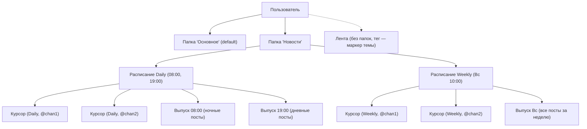
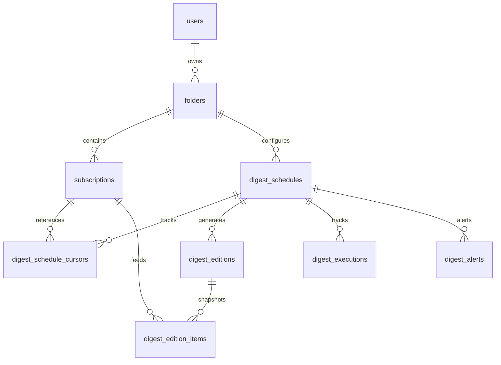
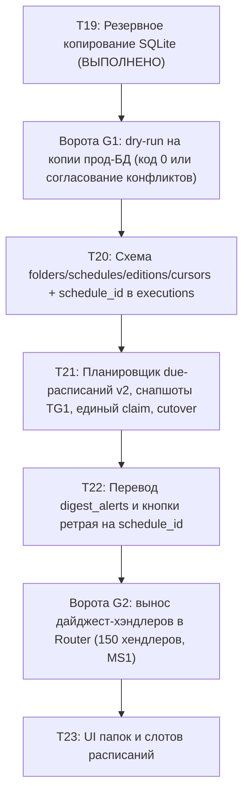

# Проект Очереди 4: несколько расписаний дайджеста на папку (Архитектура v2)

- **Статус**: Проект переработан по результатам аудита 17.10.2026 ([queue4-audit-2026-10-17.md](queue4-audit-2026-10-17.md)) и окончательным решениям владельца от 18.10.2026.
- **Окончательные решения владельца (18.10.2026)**:
  1. *Развилка курсоров — вариант (в)*: расписание = набор слотов времени (например, 08:00 и 19:00) с **ОДНИМ** курсором на пару `(schedule, subscription)`: утренний слот получает ночные посты, вечерний — дневные. Разные расписания одной папки (daily и weekly) независимы, у каждого свой курсор.
  2. *Email остаётся на legacy-пути (`period`)*: в `digest_schedules` не мигрирует; позже — отдельный JSON-контракт для сервиса `ghsub`. Dry-run не создаёт email-расписания (`email_schedules = 0`).
  3. *Формат выпуска*: новый Telegraph-формат TG1 (структурированные карточки до 3 сюжетов + список «Коротко» + оглавление), поддержан и в Telegram, и в email-письмах.
- **Границы этапа**: Текущая задача — проектная документация (`docs/sprint/queue4-design.md`), strictly read-only инструмент проверки БД (`ops/migrate_schedules_dryrun.py`) и тесты к нему (`tests/test_migrate_schedules_dryrun.py`). Код бота (`main.py`, `data/database.py`, `digest_*.py`) не модифицируется. Реализация схемы и логики запланирована в задачах T20–T23; T19 (бэкап SQLite перед деплоем) уже выполнен.

---

## 1. Модель папок дайджеста и тегов Ленты (Решения владельца 18.10)

### 1.1. Дайджест: папка как единица деления и расписаний
1. **Единица дайджеста = (пользователь, папка)**:
   - Смысл папки (в текущей схеме хранится в строке `subscriptions.tag`) — смысловая разбивка каналов и индивидуальная настройка периодичности.
   - Подписки без указания папки образуют **«Основной» дайджест** (папка `name = 'Основное'`, `is_default = 1`, либо `folder_id` по умолчанию) — он полностью равноправен пользовательским папкам.
2. **Стандартные расписания единицы дайджеста**:
   - У каждой единицы (папки) имеются стандартные типы расписаний: **день (`daily`)**, **неделя (`weekly`)**, **месяц (`monthly`)**.
   - Каждое расписание включается/выключается и настраивается абсолютно независимо от других расписаний этой же папки.
3. **Слоты времени и курсоры — Вариант (в)**:
   - Каждое расписание представляет собой **набор слотов времени** (например, `["08:00", "19:00"]`), привязанный к периоду, дням недели/месяца и транспорту доставки (Telegram).
   - На пару `(расписание, подписка)` заводится **СТРОГО ОДИН курсор** доставки (`digest_schedule_cursors`).
   - Поток постов делится **внутри расписания**: утренний слот в 08:00 собирает ночные посты и сдвигает единый курсор расписания; вечерний слот в 19:00 собирает дневные посты от сдвинутого курсора.
   - Разные расписания одной папки (например, ежедневный `daily` в 08:00/19:00 и еженедельный `weekly` в воскресенье 10:00) **полностью независимы**: у каждого расписания собственный курсор. Утренний ежедневный выпуск не опустошает еженедельную сводку.
4. **Привязка каналов к папкам и миграция**:
   - Канал пользователя принадлежит **строго одной папке** (или основному дайджесту).
   - Действующий `period` подписки при миграции превращается во «включённое расписание этого периода у папки канала».
   - Конфликты данных (один канал в нескольких папках или в нескольких периодах, расхождения времени у подписок одной папки) скрипт dry-run **показывает (код 3)**, но **НЕ разрешает автоматически** без отдельного явного запроса владельца.

### 1.2. Лента (feed): теги без папок
1. **Папок в Ленте нет**:
   - Тег подписки Ленты (`feed_subscriptions.tag`) — это исключительно **ручной текстовый маркер темы**, отображаемый перед заголовком публикации.
   - Лента ранжируется, скорится и собирается единым пулом по всем подпискам пользователя целиком; теги её на независимые выпуски не делят.
2. **Границы Очереди 4**:
   - Очередь 4 не меняет структуру и логику Ленты.
   - Вопрос канонического времени автодоставки Ленты **отложен владельцем до 24.10.2026**. Расписания дайджестов (`digest_schedules`) на автодоставку Ленты не влияют; Лента продолжает использовать существующий источник (`feed_autodelivery` / `digest_settings`).

### 1.3. Формат выпуска: единый стандарт TG1
- Все выпуски (Telegram-дайджест и email-рассылка) строятся по утверждённому формату **TG1**:
  - Оглавление с перечислением каналов.
  - Структурированные карточки: до 3 самых содержательных постов на канал с тегом `<br>` между жирным заголовком и сутью.
  - Блок «Коротко»: маркированный список ссылок-заголовков для остальных публикаций канала без дублирования названия.
- Формат TG1 зафиксирован в модуле генерации и является общим для Telegram (Telegraph) и HTML-писем.



---

## 2. Анализ существующей схемы в коде

### 2.1. Таблицы базы данных (`data/database.py:init_db`)
1. **`subscriptions`**:
   - Поля: `id`, `user_id`, `channel_username`, `channel_title`, `period`, `created_at`, `last_scraped_at`, `next_send_at`, `digest_status`, `failure_count`, `last_error`, `last_attempt_at`, `is_disabled`, `is_paused`, `tag`, `last_post_id`.
   - Уникальность: частичный индекс `uq_subscriptions_user_channel_period_active UNIQUE(user_id, channel_username, period) WHERE is_disabled = 0` (строки 774–776 `data/database.py`).
   - *Важный факт*: текущая схема намеренно допускает наличие у одного пользователя одного канала в разных периодах (например, `@x` в daily и `@x` в weekly).
2. **`digest_settings`**:
   - Поля: `user_id`, `period`, `send_hour` (default 7), `send_minute` (default 0), `weekday`, `month_day`, `monthly_mode` (default `'date'`).
   - Ключ: `PRIMARY KEY (user_id, period)`.
   - *Реальные дефолты из кода* (`digest_settings.py:110`): при отсутствии записи в БД функция `get_default_digest_settings(period, now)` возвращает `send_hour=7`, `send_minute=0`, `weekday=now.weekday()`, `month_day=now.day`, `monthly_mode='date'`. Допустимые значения `monthly_mode` в коде — `{'date', 'weekday'}`.
3. **`user_emails`**:
   - Поля: `user_id PRIMARY KEY`, `email`, `email_periods` (TEXT default `''`), `pending_email`, `verify_code`, `code_sent_at`, `code_expires_at`, `code_attempts`.
   - Решение владельца: email остаётся на legacy-пути `period`, в `digest_schedules` не переносится.
4. **`digest_executions`**:
   - Поля: `id`, `user_id`, `period`, `scheduled_at`, `started_at`, `finished_at`, `status`, `posts_count`, `channels_count`, `channels_failed`, `channels_partial`, `error_message`, `retry_count`, `created_at`.
   - Уникальность: индекс `uq_digest_executions_user_period_sched UNIQUE(user_id, period, scheduled_at)` (строки 659–660 `data/database.py`).
   - Наблюдаемые статусы в коде: `'delivered'`, `'empty'`, `'partial'`, `'failed'`, `'retrying'`.
5. **`digest_alerts`**:
   - Поля: `id`, `user_id`, `period`, `scheduled_at`, `alert_type`, `sent_at NOT NULL`, `message_id`, `error_text`, `created_at NOT NULL`.
   - Уникальность: табличное ограничение `UNIQUE(user_id, period, scheduled_at, alert_type)`.
6. **`user_prefs`**:
   - Поля: `user_id PRIMARY KEY`, `timezone`, `morning_hour`, `day_hour`, `evening_hour`, `updated_at`.
   - *Важный факт*: колонка `digest_scheduler_version` в текущей `init_db` **отсутствует**.
7. **`channel_posts`**:
   - Поля: `channel_username`, `post_id`, `post_text`, `post_link`, `post_time`, `source`, `created_at`, `views`, `reactions_total`, `reactions_json`, `forwards`, `replies`, `metrics_at`, `fwd_from_channel_id`, `fwd_from_post_id`.
   - Очистка: посты каналов удаляются регулярным cleanup через 30 дней.
8. **`channels`**:
   - Поля: `channel_username PRIMARY KEY`, `subscribers_count`, `subscribers_updated_at`, `channel_id`, `feed_backfilled_at`, `last_scanned_at`, `last_scanned_post_id`.
9. **`digest_posts`**:
   - Поля: `user_id`, `channel_username`, `post_id`, `post_time`, `post_link`. Уникальность обеспечивается отдельным индексом `uq_digest_posts_user_link UNIQUE(user_id, post_link)`.

### 2.2. Архитектурные дефекты legacy-планировщика v1
- **Отсутствие снапшота до отправки**: состав выпуска формируется «на лету» в памяти. При падении бота между вызовом Telegram API и записью статуса в SQLite повторный запуск пересобирает посты, порождая дублирование.
- **Группировка всех due-подписок до конца дня**: `plan_due_editions` подтягивает подписки через `get_user_subscriptions_due_until(day_end)`. Если у пользователя настроены утренний (08:00) и вечерний (19:00) слоты, утренний запуск забирает вечерние каналы и переносит их на следующий день, пропуская вечерний слот.
- **Жесткая связь канала с периодом**: подписка привязана к одной периодичности (`daily`, `weekly`, `monthly`), что блокирует гибкую настройку слотов.

---

## 3. Целевая схема данных (Target Schema DDL)

Модель: **папка (`folders`) → 1..N расписаний (`digest_schedules`) → выпуск (`digest_editions` + `digest_edition_items`)**.
Курсор доставки: **один курсор на пару (расписание, подписка)** в таблице `digest_schedule_cursors`.



### 3.1. DDL новых таблиц

```sql
-- 1. Папки дайджеста
CREATE TABLE IF NOT EXISTS folders (
    id INTEGER PRIMARY KEY AUTOINCREMENT,
    user_id INTEGER NOT NULL,
    name TEXT NOT NULL,
    is_default INTEGER NOT NULL DEFAULT 0,
    created_at DATETIME NOT NULL,
    UNIQUE(user_id, name)
);
CREATE INDEX IF NOT EXISTS idx_folders_user ON folders(user_id, is_default);

-- 2. Расписания дайджеста на папку (Вариант 'в': набор слотов times)
CREATE TABLE IF NOT EXISTS digest_schedules (
    id INTEGER PRIMARY KEY AUTOINCREMENT,
    folder_id INTEGER NOT NULL REFERENCES folders(id) ON DELETE CASCADE,
    user_id INTEGER NOT NULL,
    name TEXT,                                  -- Понятное имя: "Утро + Вечер", "Итоги недели"
    period TEXT NOT NULL,                       -- 'daily' | 'weekly' | 'monthly'
    times TEXT NOT NULL DEFAULT '["07:00"]',    -- Вариант (в): JSON-массив локальных слотов, e.g. ["08:00","19:00"]
    send_hour INTEGER NOT NULL DEFAULT 7,       -- Час ближайшего планового слота (0..23)
    send_minute INTEGER NOT NULL DEFAULT 0,     -- Минута ближайшего планового слота (0..59)
    weekdays TEXT,                              -- Для weekly: '0'..'6' (0=Пн, 6=Вс) или список '0,2,4'
    month_day INTEGER,                          -- Для monthly: 1..31
    monthly_mode TEXT DEFAULT 'date',           -- 'date' | 'weekday' | 'last_day'
    delivery TEXT NOT NULL DEFAULT 'telegram',  -- Только 'telegram' (email на legacy-пути)
    is_enabled INTEGER NOT NULL DEFAULT 1,
    next_send_at DATETIME NOT NULL,             -- Время ближайшего будущего слота в UTC
    last_edition_id INTEGER,                    -- Ссылка на последний созданный выпуск
    created_at DATETIME NOT NULL,
    updated_at DATETIME NOT NULL,
    CHECK (period IN ('daily', 'weekly', 'monthly')),
    CHECK (send_hour BETWEEN 0 AND 23),
    CHECK (send_minute BETWEEN 0 AND 59),
    CHECK (monthly_mode IN ('date', 'weekday', 'last_day')),
    CHECK (delivery = 'telegram')
);
CREATE INDEX IF NOT EXISTS idx_digest_schedules_due ON digest_schedules(is_enabled, next_send_at);
CREATE INDEX IF NOT EXISTS idx_digest_schedules_folder ON digest_schedules(folder_id, is_enabled);
CREATE INDEX IF NOT EXISTS idx_digest_schedules_user ON digest_schedules(user_id, is_enabled);

-- 3. Выпуски дайджеста (Снапшот до отправки, гарантия идемпотентности слота)
CREATE TABLE IF NOT EXISTS digest_editions (
    id INTEGER PRIMARY KEY AUTOINCREMENT,
    schedule_id INTEGER NOT NULL REFERENCES digest_schedules(id) ON DELETE CASCADE,
    user_id INTEGER NOT NULL,
    folder_id INTEGER NOT NULL REFERENCES folders(id) ON DELETE CASCADE,
    scheduled_at DATETIME NOT NULL,             -- Время сработавшего слота выпуска
    status TEXT NOT NULL,                       -- 'pending' | 'building' | 'ready' | 'delivering' | 'delivered' | 'partial' | 'empty' | 'failed' | 'retrying'
    delivery TEXT NOT NULL DEFAULT 'telegram',  -- 'telegram'
    delivery_target TEXT,                       -- chat_id получателя
    posts_count INTEGER DEFAULT 0,
    channels_count INTEGER DEFAULT 0,
    channels_failed INTEGER DEFAULT 0,
    channels_partial INTEGER DEFAULT 0,
    error_message TEXT,
    retry_count INTEGER DEFAULT 0,
    telegraph_url TEXT,
    created_at DATETIME NOT NULL,
    started_at DATETIME,
    delivered_at DATETIME,
    UNIQUE(schedule_id, scheduled_at)
);
CREATE INDEX IF NOT EXISTS idx_digest_editions_user_status ON digest_editions(user_id, status);
CREATE INDEX IF NOT EXISTS idx_digest_editions_sched_status ON digest_editions(scheduled_at, status);

-- 4. Состав выпуска (Зафиксированные посты снапшота, включая текст поста для ретрая)
CREATE TABLE IF NOT EXISTS digest_edition_items (
    id INTEGER PRIMARY KEY AUTOINCREMENT,
    edition_id INTEGER NOT NULL REFERENCES digest_editions(id) ON DELETE CASCADE,
    subscription_id INTEGER NOT NULL REFERENCES subscriptions(id) ON DELETE CASCADE,
    channel_username TEXT NOT NULL,
    post_id INTEGER NOT NULL,
    post_time DATETIME NOT NULL,
    post_title TEXT,
    post_text TEXT,                             -- Текст поста (гарантия ретрая при удалении из channel_posts)
    post_link TEXT NOT NULL,
    score REAL DEFAULT 0.0,
    rank INTEGER,
    created_at DATETIME NOT NULL,
    UNIQUE(edition_id, channel_username, post_id)
);
CREATE INDEX IF NOT EXISTS idx_edition_items_edition ON digest_edition_items(edition_id);
CREATE INDEX IF NOT EXISTS idx_edition_items_sub ON digest_edition_items(subscription_id);

-- 5. Курсоры доставки на пару (расписание, подписка) — Вариант (в)
CREATE TABLE IF NOT EXISTS digest_schedule_cursors (
    schedule_id INTEGER NOT NULL REFERENCES digest_schedules(id) ON DELETE CASCADE,
    subscription_id INTEGER NOT NULL REFERENCES subscriptions(id) ON DELETE CASCADE,
    last_post_id INTEGER,
    updated_at DATETIME NOT NULL,
    PRIMARY KEY(schedule_id, subscription_id)
);
CREATE INDEX IF NOT EXISTS idx_schedule_cursors_sub ON digest_schedule_cursors(subscription_id);
```

### 3.2. Модификация существующих таблиц и индексов
1. **`user_prefs`**:
   - В миграцию T20 явно добавляется колонка:
     ```sql
     ALTER TABLE user_prefs ADD COLUMN digest_scheduler_version TEXT DEFAULT 'v1';
     ```
   - Дефолт `'v1'` сохраняет работу старого планировщика для всех существующих пользователей.
2. **`subscriptions`**:
   - Добавляется колонка `folder_id INTEGER REFERENCES folders(id) ON DELETE RESTRICT`.
   - **Глобальный индекс `uq_subscriptions_user_channel` на шаге T20 НЕ создаётся**, так как текущая база содержит допустимые в v1 межпериодные дубликаты одного канала. Добавление индекса вызовет падение существующих хендлеров `add_subscription`. Уникальность канала вводится на уровне пользователя в момент его индивидуального переключения (cutover v1→v2).
3. **`digest_executions` и `digest_alerts`**:
   - Колонка `schedule_id INTEGER REFERENCES digest_schedules(id)` добавляется **уже на шаге T20**, а не откладывается на T22.
   - Для поддержки v2 без конфликта с legacy-ограничениями создаются индексы:
     ```sql
     -- Новая уникальность для v2-записей
     CREATE UNIQUE INDEX IF NOT EXISTS uq_digest_executions_schedule_slot
         ON digest_executions(schedule_id, scheduled_at) WHERE schedule_id IS NOT NULL;

     CREATE UNIQUE INDEX IF NOT EXISTS uq_digest_alerts_schedule_slot
         ON digest_alerts(schedule_id, scheduled_at, alert_type) WHERE schedule_id IS NOT NULL;
     ```
   - Исторические записи остаются с `schedule_id IS NULL` и обслуживаются прежними индексами.
4. **Включение внешних ключей**:
   - Для всех соединений `get_connection()` в `data/database.py` активируется `PRAGMA foreign_keys = ON;`.

### 3.3. Правило движения курсора доставки (Матрица статусов)

Курсор пары `(schedule_id, subscription_id)` двигается **ТОЛЬКО** при подтверждённой доставке и **строго в той же SQL-транзакции**, что и перевод статуса выпуска в `delivered` или `partial`.

| Статус выпуска (`status`) | Действие с курсорами `digest_schedule_cursors` | Транзакционность и детали |
|---|---|---|
| `delivered` | **Двигаются** до `MAX(post_id)` из снапшота для каждой подписки, чьи посты вошли в выпуск. | Выполняется атомарно: `UPDATE digest_editions SET status='delivered', delivered_at=...` + `UPDATE digest_schedule_cursors SET last_post_id=... WHERE schedule_id=? AND subscription_id=?`. Если у канала не было новых постов, курсор остаётся неизменным. |
| `partial` | **Двигаются ЧАСТИЧНО** — ТОЛЬКО для подписок/каналов, чьи посты успешно включены в доставленную часть выпуска. Для упавших каналов курсор **НЕ сдвигается**. | Атомарная фиксация статуса `partial`. Посты упавшего канала остаются за курсором и гарантированно войдут в следующий слот. |
| `empty` | **НЕ двигаются**. Выборка вернула 0 новых постов. | Курсоры остаются на месте. Обновляется только `digest_schedules.next_send_at` на следующий будущий слот расписания. |
| `failed` | **НЕ двигаются** ни для одной подписки. | Курсоры не меняются. Выпуск остаётся для алерта или повтора. |
| `retrying` | **НЕ двигаются**. Идёт повторная отправка. | Состав постов берётся **СТРОГО из `digest_edition_items`**, а не вычитывается заново по курсорам. |
| `pending` / `building` / `ready` / `delivering` | **НЕ двигаются**. Промежуточные фазы. | Курсоры не меняются до подтверждения от внешнего транспорта. |

---

## 4. Миграция данных и переходный период (Cutover v1 → v2)

### 4.1. Порядок выполнения миграции (T20)
1. **Резервная копия T19**: создание снимка `ops/aiqu/backup_db.py --tag pre-q4d` с верификацией `PRAGMA quick_check`.
2. **DDL-транзакция**: выполнение DDL новых таблиц, добавление `subscriptions.folder_id`, `user_prefs.digest_scheduler_version`, `digest_executions.schedule_id`, `digest_alerts.schedule_id`.
3. **Формирование папок по умолчанию**:
   - Папка «Основное» (`is_default = 1`) для каждого пользователя с активными подписками.
   - Папки для каждого уникального непустого `TRIM(tag)`.
4. **Генерация расписаний `digest_schedules` (только Telegram)**:
   - Для каждой папки создаются Telegram-расписания на основе активных периодов её каналов.
   - По умолчанию расписание получает слот времени из `digest_settings` пользователя для этого периода; при отсутствии строки в БД — реальный системный дефолт из кода (`07:00`, текущий день недели/месяца, `monthly_mode='date'`).
   - Слот записывается в `times = '["HH:MM"]'`, `send_hour`, `send_minute`.
   - `delivery` устанавливается строго в `'telegram'`. Email остаётся на legacy-пути.
5. **Backfill курсоров `digest_schedule_cursors`**:
   - Для каждого созданного расписания и каждой активной подписки его папки создаётся запись:
     ```sql
     INSERT INTO digest_schedule_cursors (schedule_id, subscription_id, last_post_id, updated_at)
     SELECT s.id, sub.id, sub.last_post_id, CURRENT_TIMESTAMP
     FROM digest_schedules s
     JOIN subscriptions sub ON sub.folder_id = s.folder_id
     WHERE sub.is_disabled = 0
     ON CONFLICT(schedule_id, subscription_id) DO NOTHING;
     ```
6. **Все пользователи остаются на `v1`**:
   - Поле `digest_scheduler_version` у всех пользователей равно `'v1'`. Новый планировщик их не трогает.

### 4.2. Идемпотентность и откат (Rollback)
- Миграционный скрипт выполняется в транзакции `BEGIN IMMEDIATE` с таймаутом `busy_timeout = 5000`.
- Вставка записей защищена `ON CONFLICT DO NOTHING`.
- **Откат**: в случае сбоя или отказа от релиза откат выполняется через штатную процедуру с предварительной остановкой контейнера бота (`docker compose stop unagi-bot`) и восстановлением базы через проверенный механизм `ops/aiqu/restore_db.py` (или SQLite backup API). Копирование файлов `cp` поверх живой работающей WAL-БД запрещено.

### 4.3. Cutover v1 → v2 в одной транзакции на пользователя (Без дублей и пропусков)

Перевод пользователя с версии v1 на v2 выполняется атомарно, исключая состояние «гонки» между планировщиками:

```mermaid
sequenceDiagram
    autonumber
    participant Admin as Мигратор / Админ
    participant DB as SQLite (BEGIN IMMEDIATE)
    participant V1 as Планировщик v1 (Legacy)
    participant V2 as Планировщик v2 (Target)
    
    Admin->>DB: BEGIN IMMEDIATE
    Note over Admin,DB: 1. Блокировка и проверка: нет in-flight выпусков v1 для user_id
    Admin->>DB: UPDATE digest_schedule_cursors SET last_post_id = subscriptions.last_post_id
    Note over Admin,DB: 2. Перенос актуального курсора v1 -> v2
    Admin->>DB: UPDATE digest_schedules SET next_send_at = calculate_next_slot(now)
    Note over Admin,DB: 3. Расчёт ближайшего будущего слота (исключает catch-up дубли)
    Admin->>DB: UPDATE subscriptions SET next_send_at = NULL WHERE user_id = ?
    Note over Admin,DB: 4. Исключение пользователя из выборки v1
    Admin->>DB: UPDATE user_prefs SET digest_scheduler_version = 'v2' WHERE user_id = ?
    Admin->>DB: COMMIT
    Note over V1,V2: V1 больше не видит пользователя; V2 подхватывает строго с будущего слота
```

**Пошаговый алгоритм cutover**:
1. Открывается транзакция `BEGIN IMMEDIATE`.
2. **Проверка in-flight**: проверяется, что для пользователя в данный момент не выполняется отправка выпуска в v1. Если выпуск в процессе отправки — транзакция ожидает завершения или откладывает cutover.
3. **Синхронизация курсоров**: значение `digest_schedule_cursors.last_post_id` обновляется актуальным значением `subscriptions.last_post_id`. Это ликвидирует «заморозку» курсора со времени T20 и исключает повтор уже доставленных в v1 постов.
4. **Установка следующего слота строго в будущее**: `next_send_at` для всех расписаний пользователя рассчитывается от текущего момента `now` функцией `calculate_next_slot(now)`. Это исключает ложный catch-up за время работы на v1.
5. **Снятие расписаний v1**: `subscriptions.next_send_at` выставляется в `NULL`, что гарантирует немедленное исключение пользователя из выборки `get_due_subscriptions` старого планировщика.
6. **Выставление флага**: `user_prefs.digest_scheduler_version = 'v2'`.
7. Фиксация транзакции `COMMIT`.
*Результат*: физически невозможно отправить один и тот же дайджест одновременно из v1 и v2; нет ни потери постов, ни двойной доставки.

### 4.4. Dual-write смены времени в переходный период
- В переходный период (пока часть пользователей на v1, а часть на v2) при изменении времени дайджеста через `/settings` (`reschedule_user_period`):
  1. Обновляются `digest_settings` и `subscriptions.next_send_at` (для v1).
  2. Одновременно выполняется dual-write в `digest_schedules`: обновляются `send_hour`, `send_minute`, `times` и пересчитывается `digest_schedules.next_send_at` (для v2).
- При cutover пользователя на v2 время `digest_schedules.next_send_at` дополнительно пересчитывается из актуальных настроек, гарантируя сохранение всех пользовательских изменений.

---

## 5. Планировщик v2 (Архитектура и гарантии доставки)

### 5.1. Запросы выборки и единый claim выпуска
Планировщик v2 опрашивает due-расписания каждые 60 секунд:
```sql
SELECT s.id, s.folder_id, s.user_id, s.period, s.times, s.send_hour, s.send_minute, s.next_send_at
FROM digest_schedules s
JOIN user_prefs p ON p.user_id = s.user_id
WHERE s.is_enabled = 1 
  AND s.next_send_at <= ? 
  AND p.digest_scheduler_version = 'v2'
ORDER BY s.next_send_at ASC
LIMIT 50;
```

**Единый claim выпуска (At-least-once + идемпотентность по `edition_id`)**:
- Доставка во внешний сетевой транспорт (Telegram Bot API) и транзакция в локальной SQLite не могут быть объединены в распределённую 2PC-транзакцию. Сетевая доставка фундаментально обеспечивает гарантию **at-least-once**.
- Защита от дублей и атомарный захват слота:
  ```sql
  INSERT INTO digest_editions (schedule_id, user_id, folder_id, scheduled_at, status, delivery, created_at)
  VALUES (?, ?, ?, ?, 'building', 'telegram', CURRENT_TIMESTAMP)
  ON CONFLICT(schedule_id, scheduled_at) DO NOTHING;
  ```
  - Если запись создана (`cursor.rowcount == 1`), воркер захватил слот и получил уникальный `edition_id`.
  - Если запись уже существует (конфликт по уникальному ключу `UNIQUE(schedule_id, scheduled_at)`), повторная обработка отсекается СУБД.
- Воркер формирует снапшот постов в `digest_edition_items`, переводит статус в `'ready'`, затем в `'delivering'`.
- Сообщение отправляется в Telegram с идемпотентным маркером (включающим `edition_id`).
- При успешном ответе Telegram в единой транзакции SQLite:
  1. `UPDATE digest_editions SET status = 'delivered', delivered_at = CURRENT_TIMESTAMP WHERE id = ?`.
  2. `UPDATE digest_schedule_cursors SET last_post_id = ? WHERE schedule_id = ? AND subscription_id = ?` (для всех каналов, вошедших в выпуск).
  3. `UPDATE digest_schedules SET next_send_at = calculate_next_slot(now), last_edition_id = ? WHERE id = ?`.

### 5.2. Слоты времени и один курсор на расписание (Вариант в)
- Поле `digest_schedules.times` содержит JSON-массив локальных слотов, например `["08:00", "19:00"]`.
- `digest_schedules.next_send_at` всегда указывает на **ближайший будущий слот** из списка:
  $$\text{next\_send\_at} = \min \{ t \in \text{times} \mid t > \text{now}_{\text{user}} \}$$
- После завершения доставки слота 08:00 курсор пары `(schedule_id, subscription_id)` сдвигается на максимум доставленных постов, а `next_send_at` пересчитывается на 19:00 того же дня.
- Вечерний слот в 19:00 собирает посты строго с момента сдвинутого утреннего курсора:
  ```sql
  SELECT p.post_id, p.post_text, p.post_link, p.post_time
  FROM channel_posts p
  WHERE p.channel_username = ? AND p.post_id > ?
  ORDER BY p.post_id ASC
  LIMIT ?;
  ```
- *Результат*: утренний выпуск содержит ночные публикации, вечерний — дневные. Внутри расписания посты не дублируются.
- Другие расписания этой же папки (например, еженедельное `weekly`) имеют собственный `schedule_id` и собственный курсор в `digest_schedule_cursors`, собирая все публикации за неделю без опустошения утренними дайджестами.

### 5.3. Обработка простоя и Catch-up
Если сервис был остановлен на длительное время (36 часов):
1. **Строго один объединённый выпуск на расписание**:
   - Не создаётся лавина из пропущенных выпусков на каждый пропущенный слот.
   - Снапшот создаётся один раз с `scheduled_at`, равным времени последнего наступившего слота.
   - В выпуск входят посты от сохранённого курсора `digest_schedule_cursors.last_post_id` с учётом скоринга и предохранителя `MAX_POSTS_PER_CHANNEL`.
2. **Сдвиг расписания**:
   - `next_send_at` расписания сразу переносится на ближайший будущий слот относительно текущего реального времени `now`:
     $$\text{next\_send\_at} = \text{calculate\_next\_slot}(\text{now})$$
3. **Сохранение курсора при частичной выборке**:
   - Курсор сдвигается **только по фактически включённым в снапшот `post_id`**. Невошедшие из-за лимитов публикации не отсекаются молча, а доставляются в следующем выпуске.

### 5.4. Календарные правила и граничные случаи времени

#### 5.4.1. Канонический источник времени для автодоставки Ленты
- Решение владельца: вопрос времени автодоставки Ленты **отложен до 24.10.2026**.
- Очередь 4 не изменяет Ленту.
- Расписания дайджестов (`digest_schedules`) **НЕ влияют** на время автодоставки Ленты. Каноническим источником времени для Ленты остаётся существующая связка `feed_autodelivery` и `digest_settings` в `APP_TIMEZONE`.

#### 5.4.2. Правила конца месяца (Month End Rules)
- **Зажим 29–31 чисел к последнему дню месяца**:
  - Если пользователь настроил ежемесячный дайджест на 31-е число, а в месяце меньше дней (февраль — 28/29, апрель/июнь/сентябрь/ноябрь — 30), плановый день запуска зажимается к последнему дню этого месяца:
    $$\text{effective\_day} = \min(\text{month\_day}, \text{days\_in\_month}(\text{year}, \text{month}))$$
  - В невисокосный год выпуск за 31 февраля сработает 28 февраля, а не пропустит месяц.
- **5-я неделя месяца**:
  - При режиме `monthly_mode = 'weekday'` (например, «5-я пятница месяца»), если в данном календарном месяце только 4 пятницы, срабатывание автоматически зажимается к последней (4-й) пятнице месяца.

#### 5.4.3. Правила перехода на летнее/зимнее время (DST)
Все расчёты производятся в локальном часовом поясе пользователя (`user_prefs.timezone`, либо дефолтном `APP_TIMEZONE`), после чего переводятся в UTC для хранения в `next_send_at`:
1. **Несуществующее локальное время (Spring-forward gap)**:
   - В ночь весеннего перевода стрелок час с 02:00 перескакивает на 03:00. Если расписание назначено на 02:30, локальное время не существует.
   - *Правило*: время зажимается на **первый валидный локальный момент** (03:00:00 местного времени).
2. **Неоднозначное локальное время (Fall-back overlap)**:
   - В ночь осеннего перевода стрелок интервал с 02:00 до 03:00 повторяется дважды.
   - *Правило*: используется `fold = 0` — выпуск отправляется в **первое хронологическое прохождение** этого времени, исключая задержку на 1 час.
3. **Смена часового пояса пользователем**:
   - При смене `timezone` в `/settings` в единой транзакции SQLite пересчитываются значения `next_send_at` для всех активных расписаний пользователя.

### 5.5. Crash Recovery и повтор (Ретрай)
- Если воркер упал во время отправки выпуска (статус остался `'delivering'`):
  - При рестарте бота супервизор переводит такие выпуски в статус `'retrying'`.
  - Повторная отправка выполняется **СТРОГО из снапшота `digest_edition_items`**, включая сохранённый текст поста `post_text`.
  - Обращение к таблице `channel_posts` при ретрае не производится. Это гарантирует неизменность состава дайджеста, даже если посты каналов уже удалены 30-дневным cleanup.
- Курсоры в `digest_schedule_cursors` не двигаются до тех пор, пока внешний транспорт не подтвердит доставку с HTTP 200 / message_id.

---

## 6. Конфликты данных и стратегия их обработки

Скрипт проверки базы данных `ops/migrate_schedules_dryrun.py` инспектирует БД strictly read-only и сообщает о наличии конфликтов кодом возврата **3**:

### 6.1. Типы конфликтов данных
1. **Дублирование каналов в разных периодах (один канал в нескольких периодах)**:
   - *Проблема*: канал пользователя зарегистрирован в нескольких активных строках `subscriptions` (например, в daily и в weekly с одним и тем же тегом).
   - *Статус*: **Конфликт (код 3)**. Автоматическое схлопывание через `MAX(last_post_id)` без решения владельца не применяется, так как это может привести к пропуску постов на более старом курсоре.
2. **Канал в нескольких папках (тегах)**:
   - *Проблема*: канал фигурирует в разных тегах у одного пользователя (например, в `#tech` и в `#news`).
   - *Статус*: **Конфликт (код 3)**. Требует ручного подтверждения выбора целевой папки владельцем.
3. **Расхождения времени у подписок одной папки**:
   - *Проблема*: каналы, входящие в одну и ту же папку и период, имеют разные значения `next_send_at` (рассинхронизация времени отправки).
   - *Статус*: **Конфликт (код 3)**.
4. **Некорректные параметры расписания**:
   - *Проблема*: невалидные значения `weekday` (вне 0..6), `month_day` (вне 1..31), `monthly_mode` (вне `date, weekday, last_day`) или неизвестный `period` (вне `daily, weekly, monthly`).
   - *Статус*: **Конфликт (код 3)**.
5. **Расписание без явного времени**:
   - *Проблема*: отсутствие строки в `digest_settings` или `send_hour/send_minute = NULL`.
   - *Статус*: выводится предупреждение о подстановке дефолта из кода (`07:00`, текущий день недели/месяца).

**Принцип владельца от 18.10**: dry-run **показывает все конфликты (код 3), но не разрешает их автоматически**.

---

## 7. Поэтапная нарезка задач (T19 — выполнено; T20…T23 — план)



### Ворота G1 (перед стартом T20)
- Прогон `ops/migrate_schedules_dryrun.py` на свежей копии прод-БД (полученной через T19).
- Если код 0 — чистый запуск T20.
- Если код 3 — согласование списка конфликтов с владельцем продукта до внесения изменений.

### T20. Схема данных и миграция
- Добавление таблиц: `folders`, `digest_schedules`, `digest_editions`, `digest_edition_items`, `digest_schedule_cursors`.
- Добавление колонок: `subscriptions.folder_id`, `user_prefs.digest_scheduler_version`, `digest_executions.schedule_id`, `digest_alerts.schedule_id`.
- Создание индексов с поддержкой частичной уникальности для legacy.
- Скрипт миграции `ops/migrate_schedules.py` с `BEGIN IMMEDIATE`, backfill курсоров и валидацией данных.
- Все пользователи остаются на флаге `digest_scheduler_version = 'v1'`.

### T21. Планировщик v2, снапшоты TG1, единый claim и транзакционный cutover
- Модуль `digest_scheduler.py`: опрос расписаний `v2`, единый claim слота, генерация снапшотов по формату TG1.
- Механизм слотов времени (Вариант в) с одним курсором на пару `(schedule, subscription)`.
- Реализация атомарного cutover v1→v2 на уровне пользователя.
- Dual-write смены времени дайджеста в переходный период.
- Канареечное переключение пользователей на `v2`.

### T22. Полная интеграция алертов и ретрая на schedule_id
- Перевод технического мониторинга (`digest_alerts.py`) на `schedule_id`.
- Кнопка «Повторить» в алерте перезапускает конкретный выпуск через `edition_id` / `schedule_id`.
- Идемпотентный ретрай строго из `digest_edition_items.post_text`.

### Ворота G2 (перед стартом T23)
- Вынос дайджест-хендлеров из `main.py` в Router `handlers/digest_settings.py` отдельным коммитом с проверкой неизменности 150 хендлеров и точных литералов `callback_data` (методология MS1).

### T23. UI управления папками и расписаниями
- Пользовательский интерфейс: создание и переименование папок, перемещение каналов между папками.
- Настройка расписаний: добавление/удаление слотов времени (Вариант в), включение/отключение расписаний (день, неделя, месяц).
- Полный вывод из эксплуатации планировщика v1.

---

## 8. Дорожная карта Email-доставки и связь с ghsub

- В соответствии с решением владельца от 18.10.2026:
  1. Текущая email-рассылка остаётся на legacy-пути (`subscriptions.period`, `user_emails.email_periods`).
  2. В `digest_schedules` email-расписания не мигрируют.
  3. Текст писем формируется в новом общем формате **TG1**.
  4. После стабилизации Очереди 4 формируется контракт экспорта выпуска JSON v1 в файловый спул для специализированного сервиса `ghsub`.
  5. До запуска `ghsub` пользователи с активной email-доставкой обслуживаются legacy-планировщиком v1 без риска потери писем.

---

## 9. Ответы на аудит (Сводная таблица по 6 факторам)

Ниже сведены все замечания аудита от 17.10.2026 ([queue4-audit-2026-10-17.md](queue4-audit-2026-10-17.md)) с указанием статуса и разделов настоящего документа:

| Фактор / Пункт аудита | Описание проблемы | Статус решения | Где отражено в документе |
|---|---|---|---|
| **Фактор 1. Противоречия** | | | |
| 1.1 `user_prefs.digest_scheduler_version` | Колонка отсутствует в `init_db`, планировщик упадет при JOIN | **Исправлено** | Разделы 2.1, 3.2, 4.1 |
| 1.2 Уникальность `subscriptions` | Текущий индекс допускает один канал в разных периодах; проектный `UNIQUE(user_id, channel)` сломает добавление | **Исправлено** | Разделы 2.1, 3.2, 6.1 (глобальный индекс отложен до cutover) |
| 1.3 Дефолты `digest_settings` | Расхождение кода (07:00, текущий день) и проекта (09:00 Вс, 10:00 1-е) | **Исправлено** | Разделы 2.1, 4.1, 6.1 (зафиксированы реальные дефолты из кода) |
| 1.4 Сверка колонок БД | Не указаны `source`, `reactions_json`, индекс `uq_digest_posts_user_link`, ALTER в `channels` | **Исправлено** | Раздел 2.1 |
| 1.5 Уникальные ключи executions/alerts | Простое добавление `schedule_id` не заменяет существующие DDL `UNIQUE` | **Исправлено** | Разделы 2.1, 3.2 |
| 1.6 Статусы и NOT NULL | Расхождение статусов `digest_executions` и `NOT NULL` полей `sent_at`/`created_at` в алертах | **Исправлено** | Разделы 2.1, 3.1 |
| 1.7 Нормализация тегов и слияние MAX | Разная нормализация тегов (`strip`), курсор `MAX` теряет недоставленные посты другого периода | **Исправлено** | Разделы 1.1, 6.1 (дубли периодов — конфликт код 3, без авто-слияния) |
| 1.8 Расчёт подписок в dry-run | Dry-run завышал подписки и не включал дубли периодов в `has_conflicts` | **Исправлено** | Раздел 6.1, `ops/migrate_schedules_dryrun.py` |
| **Фактор 2. Курсоры** | | | |
| 2.1 Сбой при отправке во внешний транспорт | Отправка в сеть и фиксация в SQLite не атомарны; обещание «нет дублей» неверно | **Исправлено** | Разделы 3.3, 5.1 (гарантия at-least-once + идемпотентность по `edition_id`) |
| 2.2 Семантика статуса `partial` | Внешняя отправка — единое сообщение/письмо; частичный сдвиг курсора без подтверждения транспорта опасен | **Исправлено** | Разделы 3.3, 5.1 (курсор двигается только по подтверждённым частям) |
| 2.3 Противоречие Catch-up (все посты vs 7 дней) | При жестком окне 7 дней посты старше окна теряются навсегда при сдвиге курсора | **Исправлено** | Раздел 5.3 (сдвиг курсора строго по реально вошедшим post_id) |
| 2.4 Падение каналов и `LIMIT ?` | «Упавшие каналы гарантированно войдут» не следует из catch-up с лимитом | **Исправлено** | Разделы 3.3, 5.2, 5.3 |
| 2.5 Поведение при статусе `empty` | Запрет сдвига курсора при пустой выборке создавал повторный backlog | **Исправлено** | Разделы 3.3, 5.2 (различены пустая выборка и фильтрация; сдвиг времени слота) |
| **Фактор 3. Миграция** | | | |
| 3.1 Повторный запуск миграции | `ON CONFLICT DO NOTHING` не защищает частично созданные расписания без уникального ключа | **Исправлено** | Разделы 3.1, 4.2 |
| 3.2 Откат через `cp` поверх WAL | `cp` поверх живой WAL-БД нарушает целостность SQLite | **Исправлено** | Раздел 4.2 (штатный `restore_db.py` / backup API с остановкой контейнера) |
| 3.3 Прогноз dry-run и дубли периодов | Межпериодные дубликаты не приводили к exit code 3 | **Исправлено** | Раздел 6.1, `ops/migrate_schedules_dryrun.py` |
| 3.4 Нормализация тегов `TRIM` vs raw | Разница между `NULL` и пустой строкой в SQL и Python | **Исправлено** | Разделы 1.1, 6.1, `ops/migrate_schedules_dryrun.py` |
| 3.5 Валидация email-адреса | Dry-run прогнозировал email без валидации и выбора ветки | **Снято решением владельца** | Разделы 1.1, 8 (email не мигрирует в `digest_schedules`) |
| 3.6 Валидация параметров расписания | Отсутствие проверки `weekday/month_day/monthly_mode/period` в dry-run | **Исправлено** | Раздел 6.1, `ops/migrate_schedules_dryrun.py` |
| 3.7 Безопасное открытие URI | Конкатенация URI без экранирования `?`/`#`, отсутствие перехвата исключений | **Исправлено** | `ops/migrate_schedules_dryrun.py` (`urllib.parse.quote`, exit 1) |
| 3.8 Блокировки и таймауты миграции | Наследование `busy_timeout = 5000`, `BEGIN IMMEDIATE`, откат при сбое | **Исправлено** | Раздел 4.2 |
| 3.9 CHECK и NOT NULL ограничения | Отсутствие валидации данных на уровне целевой DDL | **Исправлено** | Раздел 3.1 (введены CHECK на периоды, часы, режимы) |
| **Фактор 4. Переходный период** | | | |
| 4.1 Заморозка курсоров между T20 и v2 | v1 продолжает двигать `subscriptions.last_post_id`, курсоры расписаний отстают | **Исправлено** | Раздел 4.3 (cutover в единой транзакции с копированием курсора) |
| 4.2 Гонка при переключении флага | Смена флага во время in-flight цикла v1 дает двойную доставку в v2 | **Исправлено** | Раздел 4.3 (проверка in-flight, lease/generation, атомарный cutover) |
| 4.3 Коллизия legacy-индексов в T22 | Старые индексы executions/alerts конфликтуют с записями v2 | **Исправлено** | Раздел 3.2 (перенос `schedule_id` на T20, частичные уникальные индексы) |
| 4.4 Алерты и recovery в T21 | Алерты читают только `digest_executions`, а `schedule_id` появлялся лишь в T22 | **Исправлено** | Разделы 3.2, 7 (введение `schedule_id` уже в T20/T21) |
| 4.5 Смешанные пользователи (Email + TG) | Флаг per-user отключает email для пользователя при переходе на v2 | **Снято решением владельца** | Разделы 1.1, 8 (email на legacy-контуре v1 до ghsub) |
| 4.6 Ретрай через старую таблицу | `retry_digest_execution` обновляет `subscriptions`, игнорируя v2 | **Исправлено** | Разделы 3.3, 5.5, 7 (ретрай по `schedule_id` / `edition_id`) |
| 4.7 Глобальный `UNIQUE` ломает v1 | Добавление `uq_subscriptions_user_channel` ломает `add_subscription` в v1 | **Исправлено** | Разделы 2.1, 3.2 (индекс отложен до cutover) |
| 4.8 Смена времени после T20 | Смена времени в v1 не попадает в расписания v2 | **Исправлено** | Раздел 4.4 (dual-write в переходный период + пересчёт при cutover) |
| **Фактор 5. Зависимости** | | | |
| 5.1 Email завязан на период, а не расписание | `em_off`, смена адреса, List-Unsubscribe не видят `digest_schedules` | **Снято решением владельца** | Разделы 1.1, 8 (email остаётся на legacy-пути period до ghsub) |
| 5.2 Deep links и кнопки на `sub_id`/`period` | `dm_`, `du_`, `dsch_` не знают `folder_id` и ломают расписания v2 | **Исправлено** | Раздел 7 (версионирование payload, маппинг кнопок) |
| 5.3 Коллизия executions двух папок в 09:00 | Два daily-выпуска в одно время перезаписывают запись execution | **Исправлено** | Разделы 3.1, 3.2 (`UNIQUE(schedule_id, scheduled_at)`) |
| 5.4 Экспорт и импорт не знают новой схемы | Экспорт не содержит folders/schedules, импорт сбрасывает курсоры | **Исправлено** | Раздел 7 (формат export v3, сохранение совместимости import) |
| 5.5 `foreign_keys = OFF` и cleanup | Удаление подписок оставляет сироты в курсорах и снапшотах | **Исправлено** | Разделы 3.1, 3.2 (`PRAGMA foreign_keys = ON`, каскады) |
| 5.6 Отсутствие текста поста в снапшоте | Ретрай через 30 дней после очистки `channel_posts` шлёт пустые карточки | **Исправлено** | Разделы 3.1, 5.5 (добавлена колонка `digest_edition_items.post_text`) |
| 5.7 Время автодоставки Ленты | Лента живет на `digest_settings` и не различает расписания папок | **Отложено владельцем до 24.10** | Разделы 1.2, 5.4.1 (расписания дайджеста не влияют на Ленту) |
| 5.8 Несоответствие dry-run коду | Dry-run создавал email-расписания, использовал чужие дефолты и пропускал дубли | **Исправлено** | Раздел 6.1, `ops/migrate_schedules_dryrun.py` |
| **Фактор 6. Время** | | | |
| 6.1 Отставание курсоров при выкате | v1 двигает `subscriptions`, v2 читает старый backfill | **Исправлено** | Раздел 4.3 (перенос курсоров в транзакции cutover) |
| 6.2 Часовые пояса и жесткий `TZ` | Все расписания в `APP_TIMEZONE`, `now.tzinfo` игнорируется | **Исправлено** | Раздел 5.4.3 (настенное время пользователя, хранение в UTC) |
| 6.3 Смена часового пояса без пересчёта | При смене TZ ближайший выпуск остается по старому поясу | **Исправлено** | Раздел 5.4.3 (атомарный пересчёт `next_send_at` при смене TZ) |
| 6.4 Недетерминированные дефолты | Weekly получал текущий день недели, monthly — текущую дату | **Исправлено** | Разделы 2.1, 4.1 (документированы дефолты из кода) |
| 6.5 Режим monthly weekday | В DDL отсутствовал `monthly_mode = 'weekday'` и привязка к weekday | **Исправлено** | Разделы 3.1, 5.4.2 (поддержка `'weekday'` и `'last_day'`) |
| 6.6 Стягивание подписок до `day_end` | `plan_due_editions` забирает вечерние подписки в утренний слот | **Исправлено** | Разделы 1.1, 5.1, 5.2 (независимый опрос расписаний по `schedule_id`) |
| 6.7 Семантика конца месяца и 5-й недели | Зажим 29–31 к последнему дню и 5-й недели к последней не были специфицированы | **Исправлено** | Раздел 5.4.2 (формальные правила зажима) |
| 6.8 DST: gap и fold | Несуществующее время весной и неоднозначное время осенью не обрабатывались | **Исправлено** | Раздел 5.4.3 (gap → первый валидный момент, fall-back → `fold = 0`) |

---
